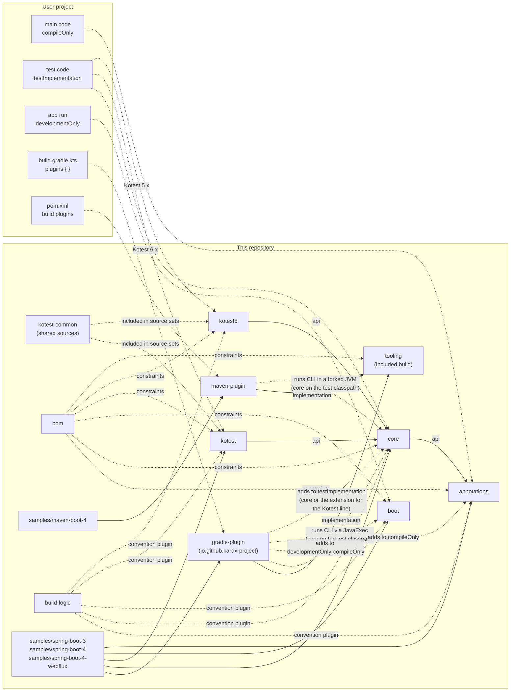
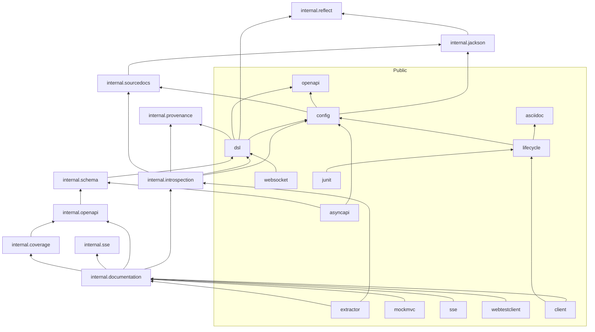

**English** | [한국어](ko/architecture.md)

# Module structure

This page explains what each module in this repository is, what it contains, and how the modules connect. It's for contributors opening the repository for the first time and for users who want to know which artifact to add as a dependency.

Usage is in [docs/](README.md), and build and verification commands are in [Development](development.md). Overlapping content is only summarized here, with links.

**Contents**

- [1. At a glance](#1-at-a-glance)
- [2. Dependency graph](#2-dependency-graph)
- [3. What users add](#3-what-users-add)
- [4. Module details](#4-module-details)
  - [annotations](#annotations)
  - [core](#core)
  - [boot](#boot)
  - [kotest](#kotest)
  - [bom](#bom)
  - [gradle-plugin](#gradle-plugin)
  - [tooling](#tooling)
  - [maven-plugin](#maven-plugin)
  - [build-logic](#build-logic)
  - [samples](#samples)
  - [docs and scripts](#docs-and-scripts)
- [5. How documents are generated](#5-how-documents-are-generated)
- [6. Build structure](#6-build-structure)

## 1. At a glance

All artifacts have the group `io.github.kardx-project`, and the version is the single `version` in `gradle.properties` (currently `0.1`).

| Directory | Published artifact | Role | Used by |
|---|---|---|---|
| `annotations/` | `io.github.kardx-project:kardx-annotations` | `@Description`, `@Masked`, `@EnumCode`, `@AsciiDescription` for DTOs and enums | User app code (`compileOnly`) |
| `core/` | `io.github.kardx-project:kardx` | The library itself. DSL, field extraction, AsciiDoc, OpenAPI fragment, and AsyncAPI generation | User tests (`testImplementation`) |
| `boot/` | `io.github.kardx-project:kardx-boot` | Logs the document URLs at INFO when the app starts | User app runtime (`developmentOnly`) |
| `kotest/` | `io.github.kardx-project:kardx-kotest` | Extension for documenting Kotest 6.x specs (`RestDocsExtension`). Snippets per leaf test, an AsciiDoc document per spec | User tests on Kotest 6.x (`testImplementation`) |
| `kotest5/` | `io.github.kardx-project:kardx-kotest5` | The Kotest 5.x version of the same extension (same package and public API). Never added together with `kotest` | User tests on Kotest 5.x (`testImplementation`) |
| `kotest-common/` | Not published | Shared sources and tests compiled into both `kotest` and `kotest5` (not a Gradle project) | Repository internal |
| `tooling/` | `io.github.kardx-project:kardx-tooling` (plus the runnable `-all` jar) | The steps after the tests without Gradle API: OpenAPI post-processing, spec check, coverage, viewer, `.http`, Postman, KDoc scanner, export and aggregation helpers, and the command line tool `ApiDocsCli` | Gradle plugin, Maven plugin, other builds (`java -jar`, `exec-maven-plugin`) |
| `bom/` | `io.github.kardx-project:kardx-bom` | Aligns the versions of the six artifacts above | User builds (`platform(...)`) |
| `gradle-plugin/` | Plugin id `io.github.kardx-project` | Adds the library and test client dependencies and sets up the documentation pipeline (index, HTML, OpenAPI, AsyncAPI, executable jar). Optional features: spec change comparison, Redoc and Scalar viewers, Postman, multi-module aggregation, WireMock stub jar | User builds (`plugins { }`) |
| `maven-plugin/` | `io.github.kardx-project:kardx-maven-plugin` (goal prefix `kardx`) | The Maven counterpart: goals `api-docs` (index, AsciiDoc sources, AsyncAPI, OpenAPI, viewer, coverage, `.http`, Postman), `check`, `baseline`, `source-docs` | User POMs (`<build><plugins>`) |
| `build-logic/` | Not published | Shared module build settings (`restdocs.*` convention plugins) | Repository internal |
| `samples/spring-boot-3/` | Not published | Boot 3.5 sample app and integration verification | Repository internal |
| `samples/spring-boot-4/` | Not published | Boot 4.1 sample app and integration verification | Repository internal |
| `samples/spring-boot-4-webflux/` | Not published | Boot 4.1 WebFlux sample app (verifies WebTestClient documentation) | Repository internal |
| `samples/maven-boot-4/` | Not published | Maven project (Java app, Kotlin tests) using the Maven plugin; not part of the Gradle build | Repository internal |

The Maven coordinates of the Gradle plugin itself are `io.github.kardx-project:kardx-gradle-plugin` (the project name in `gradle-plugin/settings.gradle.kts`). Users usually refer to it only by plugin id.

## 2. Dependency graph

Solid lines are build dependencies between modules; dotted lines show where things go in a user project.



- `core` exposes `annotations` as `api`. If you add only `core` to tests, the annotations are visible in test code. To use them in production code (main), add `annotations` separately as `compileOnly`.
- `kotest` exposes `core` as `api` and depends on the Kotest engine and the Kotest Spring extension only as `compileOnly`. `core` doesn't depend on Kotest. The lifecycle shared by the two extensions (JUnit and Kotest) is in `core`'s `lifecycle` package.
- `gradle-plugin` has no compile dependency on `core`. It runs the CLIs (`DocumentationIndexCli`, `AsyncApiCli`) of the `core` on the user's test runtime classpath with `JavaExec`.
- For Spring Boot apps, `gradle-plugin` adds `boot` of its own version to `developmentOnly`, and also to `compileOnly` without transitives so the IDE reads the configuration metadata (IntelliJ doesn't read metadata from RUNTIME-scope dependencies).
- `gradle-plugin` adds `annotations` (`compileOnly`) and `core` (or `kotest`/`kotest5` matching the declared Kotest version, `testImplementation`) of its own version, plus the REST Docs and epages MockMvc/WebTestClient modules depending on the MVC/WebFlux decision ([Dependencies added automatically](build.md#dependencies-added-automatically)).
- `core` uses `spring-restdocs-mockmvc` and `-webtestclient` only as `compileOnly`. Its published dependencies are `spring-restdocs-core` and `spring-test`, so servlet-side dependencies aren't pulled into WebFlux projects.
- `gradle-plugin` and `maven-plugin` hold only the build tool wiring. The work itself (OpenAPI post-processing, check, coverage, viewer, `.http`, KDoc scanning, export and aggregation) is in `tooling`, so both build tools and the CLI run the same code and write the same files.
- `maven-plugin` has no compile dependency on `core` either. Its `api-docs` goal runs `DocumentationIndexCli` and `AsyncApiCli` on the project's test classpath in a forked JVM.
- `kotest` and `kotest5` publish the same Gradle capability (`io.github.kardx-project:kardx-kotest-extension`), so Gradle reports a conflict if both come in.

## 3. What users add

It's published to Maven Central; the Gradle plugin is there too, so `pluginManagement` also needs `mavenCentral()`. The full setup is in [Getting started](getting-started.md#installation). The following is for Boot 4; for Boot 3 versions, see [Differences in Boot 3](getting-started.md#differences-in-boot-3).

**With the Gradle plugin (recommended)**

The plugin adds the library artifacts, so you don't declare `io.github.kardx-project` dependencies. Declare only the app starter (`-web` / `-webflux`) and (if you use Kotest) the `io.kotest` dependencies.

```kotlin
plugins {
    id("org.springframework.boot") version "4.1.2"
    id("io.spring.dependency-management") version "1.1.7"
    id("org.asciidoctor.jvm.convert") version "4.0.5"
    id("com.epages.restdocs-api-spec") version "0.20.2"        // only when producing OpenAPI. Boot 3: 0.19.4
    id("io.github.kardx-project") version "0.1"
}

dependencies {
    implementation("org.springframework.boot:spring-boot-starter-web")
    testImplementation("org.springframework.boot:spring-boot-starter-test")
}
```

| Project | What the plugin adds |
|---|---|
| All | `annotations` (`compileOnly`), and `boot` (`developmentOnly`) for Spring Boot apps |
| JUnit | `core` |
| Kotest 6.x / 5.x (when an `io.kotest` version is declared) | `kotest` / `kotest5` (brings in core) |
| MVC app (`spring-boot-starter-web`, `-websocket`, `spring-webmvc`) | `spring-restdocs-mockmvc`, plus `restdocs-api-spec-mockmvc` if epages is present |
| WebFlux app (`spring-boot-starter-webflux`, `spring-webflux`) | `spring-restdocs-webtestclient`, plus `restdocs-api-spec-webtestclient` if epages is present. The `spring-boot-starter-web` that epages pulls in is removed |
| Messages only (no web starter) | `core` only (message documentation works without MockMvc) |

To view OpenAPI in Swagger UI, add springdoc to the app and `springdoc.swagger-ui.url: /docs/openapi3.yaml` ([application.yml](getting-started.md#4-applicationyml-production)). Examples are [samples/spring-boot-4-webflux](../samples/spring-boot-4-webflux) (WebFlux) and [samples](../samples). The message documentation API and the AsyncAPI generator are in `core` ([SSE · WebSocket · AsyncAPI](messaging.md)).

**Without the plugin**

The dependencies to declare yourself are in [Dependencies without the plugin](getting-started.md#dependencies-without-the-plugin). In short: `annotations` in production `compileOnly`; in tests, `core` (for Kotest, the one `kotest`/`kotest5` for your line) and `spring-restdocs-mockmvc` or `-webtestclient`; the epages module for OpenAPI; and `boot` if you want the startup log.

```kotlin
dependencies {
    developmentOnly("io.github.kardx-project:kardx-boot:0.1")
    // So IntelliJ knows the kardx.* keys in application.yml (not included in the executable jar)
    compileOnly("io.github.kardx-project:kardx-boot:0.1") { isTransitive = false }
}
```

**Aligning versions with the BOM**

```kotlin
dependencies {
    val kardx = platform("io.github.kardx-project:kardx-bom:0.1")

    compileOnly(kardx)
    compileOnly("io.github.kardx-project:kardx-annotations")

    testImplementation(kardx)
    testImplementation("io.github.kardx-project:kardx")
    testImplementation("org.springframework.restdocs:spring-restdocs-mockmvc")
}
```

The BOM contains only `annotations`, `core`, `boot`, `kotest`, and `kotest5`. The Gradle plugin version goes separately in `plugins { }`.

## 4. Module details

### annotations

**Role.** Contains only the annotations placed on user code (DTOs, enums, documentation tests). It's split out so that production code doesn't drag in the test library (`core`) and its dependencies (REST Docs and so on). Added as `compileOnly`, it's not included in the production jar.

**Coordinates and dependencies.** `io.github.kardx-project:kardx-annotations`. The only dependency is the Kotlin stdlib. The `Automatic-Module-Name` is `io.github.kardx.annotation`.

**Contents** (package `io.github.kardx.annotation`, all with `RUNTIME` retention)

| Annotation | Use |
|---|---|
| `@Description(value)` | Description of a field, parameter, or enum constant |
| `@EnumCode(value, codeProperty, descriptionProperty)` | Marks an enum for which `EnumDocumentationExtension` builds a `Code` / `Description` table (classes only). If left empty, the code is the JSON value and the description is `description` and the like |
| `@Masked(value)` | Marks a field whose value goes out masked (documentation only; the value isn't changed). `*Masked*: value` in the field table, `x-masked` and `x-masked-rule` in OpenAPI and AsyncAPI |
| `@AsciiDescription` | Placed on test classes and methods; a description appended after the document and section titles of the generated AsciiDoc. The value on a test class becomes the description of the OpenAPI top-level `tags` (Gradle plugin) |

**Tests.** This module has no tests. Reading the annotations is verified by `core`'s tests.

**Things to watch when changing it**

- `explicitApi()` is on, and the public API is pinned in `annotations/api/annotations.api`. If you change it, update it with `./gradlew apiDump`.
- Don't make it depend on other libraries. This module goes on the compile classpath of users' production code.

### core

**Role.** The library itself. It contains the Kotlin DSL used in MockMvc, WebTestClient and RestTestClient tests (`andDocument { }`), the extractors that pull fields from types, AsciiDoc document generation per test class, the OpenAPI (epages) integration, and SSE, WebSocket, and STOMP message documentation with AsyncAPI generation. It goes only on the user's test classpath.

**Coordinates.** `io.github.kardx-project:kardx`. The `Automatic-Module-Name` is `io.github.kardx`.

**Dependencies** (`core/build.gradle.kts`)

| Kind | Targets |
|---|---|
| `api` | `annotations`, `kotlin-reflect`, `spring-restdocs-core` (declared at the supported minimum 3.0; the actual version is decided by the user's Boot BOM), `spring-test` |
| `compileOnly` | `spring-restdocs-mockmvc` and `jakarta.servlet-api` (MockMvc entry points), `spring-restdocs-webtestclient` and `spring-webflux` (WebTestClient entry points), `spring-web`, `spring-websocket`, `spring-context`, `spring-core`, `junit-jupiter-api`, `jakarta.validation-api`, epages `restdocs-api-spec`, `assertj-core` (`MockMvcTester` entry point) |
| Looked up by class name only | Jackson 2 (`com.fasterxml.jackson.databind.ObjectMapper`) and Jackson 3 (`tools.jackson.databind.json.JsonMapper`), description annotations set in yml (Swagger `@Schema` and so on). No compile dependency |

Among the `compileOnly` dependencies, epages and Jakarta Validation are optional features, used only when their classes are present (`loadClassOrNull` in `internal/reflect/ClassLoading.kt`). epages classes are referenced only from a separate object in `internal/openapi/OpenApiSupport.kt`, so they aren't loaded without epages. Whether epages is present is decided by its core class (`ResourceDocumentation`), so either `restdocs-api-spec-mockmvc` or `-webtestclient` works. The WebTestClient, MockMvc, and `MockMvcTester` entry points also load their classes only when you call functions in those files, so everything else works in projects without those dependencies. Message documentation (`MessageDocumentation`) builds the configuration map directly with spring-restdocs-core's configurer (`RestDocumentationConfigurer`) and works without MockMvc (`internal/websocket/DocumentationConfigurationMap.kt`). This promise is enforced by the source set `noServletTest` (`core/src/test/noServlet`, task `:core:noServletTest`, part of `check`): on a classpath with only the published dependencies (`project(":core")`) and the WebFlux and STOMP side (no `spring-restdocs-mockmvc`, `spring-webmvc`, or servlet API), it loads and initializes every public class outside `mockmvc`, `sse`, and `internal`, and actually runs the JUnit extension plus WebTestClient and message documentation.

**RestTestClient source set.** `RestTestClient` exists only in Spring Framework 7, while the main source set compiles against Spring 6 and REST Docs 3. So the RestTestClient entry points (package `io.github.kardx.resttestclient`, 6 files in `core/src/main/restTestClient`, one of them Java) are a separate source set `restTestClient`, compiled against Spring Framework 7 and REST Docs 4 (`compileOnly`), and packed into the same jar and sources jar. The classes are loaded only when a user calls them, so Boot 3 projects never touch them. They convert the `ExchangeResult` themselves with `RestDocumentationGenerator` from `spring-restdocs-core`, so the `spring-restdocs-resttestclient` module (REST Docs 4.1) isn't needed. The source set is deliberately not a friend of the main source set: it uses only the public client adapter SPI (`io.github.kardx.client.ClientDocumentation`, see [Client adapter SPI](#client-adapter-spi)), so its compilation checks that the SPI is enough for a real adapter. Only its tests (`restTestClientTest`) see core's `internal` declarations. Tests live in `core/src/test/restTestClient` and run with `:core:restTestClientTest` (part of `check`); `apiValidation` dumps the source set's public API into `core/api/core.api` too.

**Package principles.** Top-level packages (`io.github.kardx.<name>`) hold only what users import; implementations go in `io.github.kardx.internal.*`. Declarations under `internal` are Kotlin `internal`, and only the `@PublishedApi` declarations called by public inline functions (`serializeJson`, `deserializeJson`, `TypeCapture` in `internal.jackson`) appear public. They are ABI that ends up in user binaries, so they aren't excluded from the API dump (`ignoredPackages` is not used). There are no cycles in the dependencies between packages. `python3 scripts/check-package-cycles.py` checks this, and the root task `checkPackageCycles` (part of `check`) runs it, so `./gradlew build` fails on a cycle.

The `lifecycle` package is public, but every declaration carries `@RestDocsExtensionApi`, a `@RequiresOptIn` annotation, so using it without `@OptIn` is a compile error. It's public because another module (`kotest`) can't see Kotlin `internal`, and only people building test framework extensions use it.

Some public APIs are still being refined and carry `@ExperimentalRestDocsApi` (package `io.github.kardx`, a `@RequiresOptIn` at warning level): KDoc/Javadoc descriptions (`descriptions.sourceDocs`, `DescriptionResolver.SOURCE_DOCS`, `FromParamTag`, parameters declared by name only), the client adapter SPI (`client`), and the messaging test tools (`StompTestClient`, `WebSocketHandlerTester`). They may change or be removed in a later release and are outside the 1.0 compatibility promise. Users opt in with `@OptIn(ExperimentalRestDocsApi::class)` or module-wide with `kotlin { compilerOptions { optIn.add("io.github.kardx.ExperimentalRestDocsApi") } }`.

Callbacks in the settings and extensions are `fun interface`s (`DescriptionResolver`, `ValueMasker`, `ObjectMapperProvider`, `PropertyNameStrategy`, `SchemaNameResolver`, `OperationIdResolver`, `DocumentGeneratorFactory`, Kotest `SectionTitleProvider` and `SnippetNameProvider`), not Kotlin function types. Their inputs (`PropertyContext`, `MaskTarget`, `OperationIdInput`, `DocumentGeneratorContext`, `TestPath` …) are classes with `internal` constructors that only the library creates, so a property can be added later without breaking user code or binaries.

**Public packages**

| Package | Responsibility | Representative classes and functions |
|---|---|---|
| `dsl` | Item syntax and field types, `andDocument { }` and message blocks, declared error responses, per-section relaxed verification, validation failure exceptions, descriptor attribute keys | `"id" pathMeans`, `"name" type STRING`, `DocsFieldType`, `RestDocsField`, `DocumentationBuilder`, `OpenApiBuilder`, `ErrorResponseBuilder`, `DeclaredErrorResponse`, `RelaxedSection`, `MessageDocumentationBuilder`, `MessageDirection`, `DocumentationMismatchException`, `CONSTRAINTS_ATTRIBUTE` |
| `extractor` | Extracting fields and parameters from types, shortcuts inside blocks (including `fields<T>()` of `errorResponse { }`), list adjustments (fields and parameters), parameter types, list preview | `responseFieldsOf<T>()`, `requestFieldsOf<T>()`, `parametersOf<T>()`, `wrappedResponseFieldsOf<T>()`, shortcuts `responseFields<T>()`, `requestFields<T>()`, `wrappedResponseFields<T>()`, and message `fields<T>()`, `except`, `optionalAt`, `optionalUnder`, `withFields`, `ofType`, `describe()` |
| `mockmvc` | MockMvc entry points (`MvcTestResultExtensions.kt` is loaded only on Spring 6.2+) | `.andDocument` on `ResultActions`, `ResultActionsDsl`, and `MvcTestResult`, `restDocsMockMvc`, `jsonContent`, `bearerToken`, `performAsync` |
| `webtestclient` | WebTestClient entry points and setup helpers (loaded only when `spring-restdocs-webtestclient` and `spring-webflux` are present) | `ResponseSpec`, `BodyContentSpec`, `BodySpec.andDocument`, `restDocsWebTestClient`, `WebTestClient.Builder.restDocs`, `MockServerSpec.recordHandlers` |
| `sse` | Receiving never-ending SSE streams (the event item syntax `events(...)` is in `dsl`) | `MockMvc.performStream` |
| `websocket` | WebSocket and STOMP message documentation, handler tests, a STOMP client for tests | `MessageDocumentation`, `WebSocketHandlerTester`, `StompTestClient`, `StompSubscription`, `StompFrame` |
| `config` | Global settings, yml settings, response wrappers, description annotations, snippet kinds and section order of generated documents, documentation language | `RestDocsConfiguration`, `RestDocsSettings`, `DocsLanguage`, `ResponseWrapper`, `DescriptionAnnotation`, `DescriptionResolver`, `ValueMasker`, `MaskTarget`, `SnippetFile`, `DocumentSectionOrder` |
| `junit` | JUnit 5 extensions. Reads test classes by reflection to build the document structure (`DocumentOutline`) and leaves the lifecycle to `lifecycle` | `AutoRestDocumentationExtension`, `EnumDocumentationExtension` (`JUnitDocumentOutline` is internal) |
| `lifecycle` | Test-framework-independent documentation lifecycle and document structure model. Opt-in API for building extensions (`@RestDocsExtensionApi`, not for regular test code). Shared by the JUnit and Kotest extensions | `DocumentationLifecycle`, `DocumentationRun`, `DocumentOutline`, `DocumentSection`, `SpringContextSettings`, `EnumCodeDocumentation` (`AsciiDocumentWriter` is internal) |
| `asciidoc` | AsciiDoc document layout, Enum code document format, document index, index CLI | `DocumentGenerator`, `DocumentGeneratorFactory`, `EnumDocumentFormat`, `AsciiDocEnumDocumentFormat`, `DocumentationIndex`, CLI `DocumentationIndexCli` |
| `openapi` | OpenAPI schema names, operationId rules | `SchemaNames`, `OperationIdRule`, `OperationIdInput`, `SchemaNameResolver`, `OperationIdResolver` |
| `asyncapi` | AsyncAPI 3.0 document and viewer generation, security schemes, CLI | `AsyncApiGenerator`, `AsyncApiInfo`, `AsyncApiServer`, `AsyncApiSecurityScheme`, `AsyncApiSecurityType`, `AsyncApiApiKeyLocation`, CLI `AsyncApiCli` |
| `client` | Client adapter SPI for documenting other HTTP test clients (`@RestDocsExtensionApi` + `@ExperimentalRestDocsApi`) | `ClientDocumentation` |
| `resttestclient` | RestTestClient entry points (Spring Framework 7 only; separate source set, see above). Built on `client` | `ResponseSpec`, `BodyContentSpec`, `BodySpec.andDocument`, `RestTestClient.Builder.restDocs` |

**Internal packages** (`io.github.kardx.internal.*`)

| Package | Responsibility |
|---|---|
| `reflect` | Class loading, classpath scanning, reading annotation values, reading an enum's JSON value and properties, declared field order, annotations of a method and its first parameter, interface delegation proxies (`GetterOverride`). Depends on no other package of this repository |
| `jackson` | Finding Jackson 2 and 3 mappers and serializing, generic type capture |
| `http` | Absorbing the `HttpHeaders` differences between Spring 6 and 7, status text (`409 Conflict`), masking sensitive header values, replacing non-text bodies with `<binary: N bytes>` (text decided by Content-Type), what a file body is (`FileBody`: media type without charset, file name, original size), converting MockMvc response bodies to types (shared rules of `andReturnAsObject` and `andReturnEntity`) |
| `output` | Location, name, and order of outputs (test → document and snippet paths, `@DisplayName` (JUnit and Kotest), JUnit order, `@AsciiDescription`) and atomic file writes, document info of the running test (`RunningTest`, bound to the coroutine by the Kotest extension), OpenAPI and AsyncAPI tags and summaries (`OperationTitles`), per-class document records (`DocumentRecord`: index entries and whether headers were masked, `.restdocs-documents/`) |
| `introspection` | Type analysis and field extraction (properties, fields of an `errorResponse` example object (`ExampleFields`), Jackson naming rules, sealed, Spring Data, ProblemDetail, Bean Validation constraints, type and constraint schema fragments). Type handling is split by job: unwrapping `Optional`, value classes and `@JsonValue` (`Unwrapped.kt`), generic type parameter bindings (`TypeBindings.kt`), Java `Type` → `KType` (`JavaTypes.kt`) |
| `schema` | Building JSON Schema from field lists (AsyncAPI payloads, multipart parts) |
| `diagnostics` | Wrapping validation failures (missing or extra, field type mismatch) into messages with path lists, DSL suggestions, and cause hints |
| `openapi` | epages resource snippets, relaxed parameter sections (`RelaxedParameters`), security schemes (including `bearerAuth()` and `basicAuth()` declared without headers), global headers, schema name sources, `openapi-extras.json`, operationId candidates (recording the handler that handled the request, names per rule), reading handler parameter types (`HandlerParameters`) and `@Deprecated` (`HandlerDeprecation`), the warning for undocumented path variables (`UndocumentedPathVariables`) |
| `asyncapi` | Writing and reading AsyncAPI records (`*.asyncapi.json`), message schemas, YAML writing, viewer (comments are stripped from the inlined CSS and JS: `WebComments`, `CommentScanner`) |
| `websocket` | Turning messages into REST Docs requests, message snippets, recording WebSocket sessions, payload text and the raw-text STOMP converter used by `StompTestClient` (`PayloadText`, `RawTextMessageConverter`, `StompSubscriptionCancel`), building the REST Docs configuration map without MockMvc (`DocumentationConfigurationMap`) |
| `sse` | SSE body parsing, the event table and event `data` field snippets, and AsyncAPI records |
| `documentation` | Running `andDocument`: block → spec → snippet list, declared error responses (`ErrorResponsesSnippet`, example check `ErrorExampleCheck`, `ErrorResponseExamples`, dropping the received status `ReceivedErrorResponse`), file body tables (`FileBodySnippet`) and plain `[source]` blocks for binary bodies (`BinaryBodyBlocks`), filling parameter types and deprecation not set in the block from the handler (`HandlerDefaults`), preprocessing, api-summary and WireMock snippets, stream freezing (`StreamSnapshot`), list preview tables |
| `asciidoc` | Choosing snippet files (`SnippetFileListExtractor`), writing the Enum code document. Writing per-class documents (`AsciiDocumentWriter`) is in `lifecycle` |
| `i18n` | Per-language catalogue of the texts put into generated documents and specs, plus the language mismatch warning. `DocsText` (index heading and links, schema description prefixes, automatic descriptions for Spring Data, `ProblemDetail` and sealed types, AsyncAPI channel notes, file body table labels), `LocalizedText` (picks the language when a long-cached description is written), `ViewerText` (AsyncAPI viewer UI texts; only the chosen language goes into the page as JSON), `PluginLanguageWarning` (one WARN per JVM on the `io.github.kardx.config` logger when the documentation language differs from the language the Gradle plugin passes to the test JVM; no warning without the plugin). The Korean texts equal the output from before the language setting. Log and exception messages are not kept here; they are written in English |
| `sourcedocs` | Reading the KDoc/Javadoc index that the Gradle plugin's `apiDocsSourceDocs` writes (`SourceDocs`, `SourceDocsIndex`), the last source of descriptions |
| `coverage` | The endpoint inventory for documentation coverage: the endpoints the application context maps (`EndpointInventory`, `MappedEndpoint`, `MappedEndpoints`), written under `.kardx/endpoints/` for `apiDocsCoverage` |
| `provenance` | Where an extracted field came from (`FieldOrigin`, `FieldSource`), carried by the field so that the default schema name survives list edits. Depends on no other package of this repository, so `dsl` and `internal.introspection` don't depend on each other |
| `spring` | Reading settings and the ObjectMapper from the Spring application context and `Environment`, warning about unknown `kardx.*` keys (`UnknownPropertyWarnings`, key matching in `PropertyKeys`) |

The only implementations left as Kotlin `internal` in public packages are those that call and are called by public types; splitting them out would create package cycles: `ExternalSettings` (yml → `RestDocsSettings`) and `DescriptionResolvers` (the built-in description steps) in `config`, `AsyncApiDocumentBuilder` (reads `AsyncApiInfo`), `AsyncApiSecuritySchemes` and the CLI in `asyncapi`, the index CLI in `asciidoc`, and in `dsl`, the `ParameterSection` and `DocsFieldType` conversion functions and the descriptor attribute keys (`DescriptorAttributes.kt`, `internal` constants next to the public constant `CONSTRAINTS_ATTRIBUTE`; a string contract with the Gradle plugin).

`StreamSnapshot` in `internal.documentation` (freezing never-ending streams) lives in `internal.documentation`, not `internal.sse`. Its result type `StreamResultActions` extends `MvcResultActions`, and `internal.documentation` uses the SSE snippets (`internal.sse`), so moving it would create a cycle.

**Layers** (lower ones first. Arrows mean "depends on". Packages on the same line don't depend on each other)

```
L9  client   extractor   mockmvc   sse   webtestclient   (resttestclient, separate source set)
L8  junit   internal.documentation
L7  asyncapi   lifecycle   websocket   internal.coverage   internal.sse
L6  internal.asciidoc   internal.asyncapi   internal.diagnostics   internal.openapi
L5  asciidoc   internal.introspection   internal.schema   internal.spring   internal.websocket
L4  dsl   internal.http   internal.i18n   internal.output
L3  config
L2  internal.sourcedocs
L1  internal.jackson
L0  openapi   internal.provenance   internal.reflect
```



The diagram shows only the main flow. `python3 scripts/check-package-cycles.py --graph core/src/main/kotlin` prints all edges.

The two CLIs (`io.github.kardx.asciidoc.DocumentationIndexCli`, `io.github.kardx.asyncapi.AsyncApiCli`) are `internal fun main` with names pinned by `@file:JvmName`. They're not public API, but the JVM class names and command-line options are a contract with the Gradle plugin. Other top-level functions (including the `extractor` package) don't use `@file:JvmName` and go into Kotlin's default file classes (`…Kt`). The DSL is used only from Kotlin, so those names are invisible to Kotlin users.

**Resources** (`core/src/main/resources`)

- `org/springframework/restdocs/templates/asciidoctor/*.snippet`: 17 snippet templates that override the REST Docs default templates or add the library's own (`request-fields`, `api-summary`, `error-responses`, `file-body`, `message`, `sse-events`, and so on). `templates/markdown/` also has `api-summary`, `error-responses`, `file-body`, `message`, and `sse-events`. The path is defined by REST Docs, so it's unrelated to the library package.
- `io/github/kardx/internal/asyncapi/viewer.html`, `viewer.css`, `viewer.js`: the AsyncAPI viewer. `AsyncApiViewer` reads them relative to its own package and inlines the CSS and JS into the HTML to make a single file (move them together if you move the class).
- `META-INF/spring-configuration-metadata.json`: metadata the IDE uses to autocomplete the `kardx.*` test settings. The single source is `src/main/resources/META-INF/additional-spring-configuration-metadata.json`, and the build (`processResources`) renames it to the standard name in the jar. `sourceType` and `type` contain class names from `config`.
- `core/Module.md`: the module description for Dokka (javadoc jar).

**Tests.** `core/src/test` has Kotest `BehaviorSpec` tests in the same packages as their targets, and Java classes for testing the extractors are in `extractor` under `src/test/java`. `io.kotest.provided.ProjectConfig` resets `RestDocsConfiguration` after every test. Run them with `./gradlew :core:test`. Contract tests worth noting:

- `ConfigurationMetadataTest`: that the metadata JSON contains every supported property and the `RestDocsSettings` defaults
- `PublicValueClassesTest`: `equals`/`hashCode`/`toString` of public value classes
- `CliEntryPointTest`: that the CLI classes run by the Gradle plugin have a `main`
- `JacksonCompatibilityTest`: extraction of Jackson-side shapes such as `@JsonProperty`, `@JsonTypeInfo`, and `JsonNode`

**Things to watch when changing it**

- It compiles against the Spring REST Docs 3.0 / Spring Framework 6 API and keeps binary compatibility with REST Docs 4.0 / Spring 7. `samples/spring-boot-4` verifies the compatibility. APIs that differ between versions are bridged with reflection (`internal.http`, `internal.reflect`, `internal.openapi`) and kept in one place.
- Don't import Jackson classes directly. To support both Jackson 2 and 3, they're looked up by class name (`internal/jackson/DefaultObjectMapper.kt`).
- New files follow the package principles. Put what users don't import in `internal.*`, and after adding it, check for cycles with `python3 scripts/check-package-cycles.py`.
- The public API is managed with `explicitApi()` and `core/api/core.api`. If you change it, run `./gradlew apiDump`; `check` verifies it with `apiCheck`. The rule against data classes in the public API and how to keep constructors compatible are in [Development](development.md).
- Some values are coupled to the Gradle plugin by strings. If you change one side, change the other too.
  - CLI class names (`io.github.kardx.asciidoc.DocumentationIndexCli`, `io.github.kardx.asyncapi.AsyncApiCli`) and options ↔ plugin `IndexTasks`, `AsyncApiTasks`, core `CliEntryPointTest`
  - `AsyncApiMetadata.FILE_SUFFIX` (`.asyncapi.json`) ↔ `**/*.asyncapi.json` in `AsyncApiTasks`
  - `internal/openapi/OpenApiGlobalHeaders.FILE_NAME` ↔ plugin `OpenApiGlobalHeaders.SETTINGS_FILE`
  - `internal/openapi/OpenApiOperationExtras.FILE_NAME` (`openapi-extras.json`) and key names ↔ plugin `OpenApiResources.EXTRAS_FILE`, `OpenApiRequestExtras`, `OpenApiFileBodies`
  - Descriptor attribute keys (`schema`, `constraintNote`, `requiredByConstraint`, `requiredInParent`, `nullable`, `nullableItems`, `default`, `example` in `dsl/DescriptorAttributes.kt`) ↔ plugin `DescriptorHints`
  - System properties `kardx.snippets.directory`, `kardx.asciidoc-directory` ↔ `TestTaskSetup`
- When you add a yml setting, also update `META-INF/additional-spring-configuration-metadata.json` (`ConfigurationMetadataTest` catches it).

#### Client adapter SPI

The documentation behind `andDocument` (block → snippets, OpenAPI fragment, WireMock mapping, with the masking and preprocessors from the settings) is open to other HTTP test clients (Ktor, RestAssured …) through `io.github.kardx.client.ClientDocumentation`. The library's own RestTestClient adapter is built only on it. It needs both `@OptIn(RestDocsExtensionApi::class)` and `@OptIn(ExperimentalRestDocsApi::class)`. An adapter does two things:

1. Before sending a request (or in a client interceptor), it calls `ClientDocumentation.configuration(provider)`. This returns the REST Docs configuration map for that request (context, template engine, default HTTP snippets) and advances the context's step counter, so call it exactly once per request.
2. When the response arrives, it calls `ClientDocumentation.document(...)` with that map and converters from the client's request and response to REST Docs `OperationRequest` and `OperationResponse`.

```kotlin
@OptIn(RestDocsExtensionApi::class, ExperimentalRestDocsApi::class)
fun HttpResponse.andDocument(block: DocumentationBuilder.() -> Unit) {
    ClientDocumentation.document(
        exchange = this,
        requestConverter = KtorRequestConverter,       // HttpResponse -> OperationRequest
        responseConverter = KtorResponseConverter,     // HttpResponse -> OperationResponse
        configuration = call.attributes[RestDocsConfigurationKey], // ClientDocumentation.configuration(provider), made before sending
        status = status.value,
        urlTemplate = call.attributes.getOrNull(UrlTemplateKey),
        block = block,
    )
}
```

| Argument | Purpose |
|---|---|
| `exchange`, `requestConverter`, `responseConverter` | The client's exchange and the converters it is passed to |
| `configuration` | The map from `configuration(provider)` for this request |
| `status` | Response status code. Used for error response schema names and declared `errorResponse`s |
| `urlTemplate` | Request URL template (`/users/{id}`). Without it, path parameters can't be documented |
| `handler` | The Spring `HandlerMethod` that handled the request, if known. Used for the operationId and parameter type defaults |
| `rawResponseBody` | The response body before preprocessing. Used for WireMock mappings of binary bodies |
| `applicationContext` | The app context that handled the request. Used for the endpoint inventory of documentation coverage |
| `block` | The `andDocument { }` block |

`ClientDocumentation.DOCUMENT_IDENTIFIER` is the REST Docs document identifier (`{class-name}/{method-name}`) the snippet directory comes from. The JUnit and Kotest extensions work as usual, because the adapter goes through the same REST Docs context.

### boot

**Role.** Logs the REST Docs, Swagger UI, OpenAPI, and AsyncAPI URLs at INFO when a Spring Boot app starts. `core` is test-only, and this feature is needed at app runtime, so it's split out. By default it goes into `developmentOnly` and works only for IDE runs and `bootRun`.

**Coordinates and dependencies.** `io.github.kardx-project:kardx-boot`. Uses `spring-boot` (version 3.5) and `spring-core` only as `compileOnly`. Boot comes from the user's app. The `Automatic-Module-Name` is `io.github.kardx.boot`.

**Contents** (package `io.github.kardx.boot`)

| Class | Public | Contents |
|---|---|---|
| `ApiDocsStartupLogger` | Yes | `ApplicationReadyEvent` listener. Logs once per context. Includes the Swagger UI line only when the springdoc UI class is present |
| `StartupLogLanguage`, `StartupLogText` | No | The language of the startup log texts and the per-language default texts. The language is the app setting `kardx.language`, otherwise the `language` the plugin recorded in `docs-locations.properties`, otherwise `en`. An unsupported value logs one warning and falls back to English (a typo in a docs setting must not stop the app). boot doesn't depend on core, so it doesn't use core's `DocsLanguage` |
| `ApiDocsLocations` | No | Computes the URLs from `META-INF/kardx/docs-locations.properties` left by the Gradle plugin (default document path and file names; yml takes precedence), the app settings (port, `server.servlet.context-path` or `spring.webflux.base-path` for WebFlux apps, `spring.mvc.servlet.path`, `server.ssl.enabled`, `springdoc.swagger-ui.path`), and static resources. Shows only the documents that actually exist |

**Resources**

- `META-INF/spring.factories`: registers `ApiDocsStartupLogger` as an `ApplicationListener`. It works as soon as the dependency is present.
- `META-INF/spring-configuration-metadata.json` (source: `additional-spring-configuration-metadata.json`): autocompletion for `kardx.docs-path` and `kardx.startup-log.*`.

**Tests.** `ApiDocsLocationsTest` (Kotest). `./gradlew :boot:test`.

**Things to watch when changing it**

- It compiles against the Boot 3 API and keeps binary compatibility with Boot 4. The samples use this module the way the Gradle plugin adds it (`developmentOnly`, plus `compileOnly` for IDE metadata). Inside the repository, those published coordinates are substituted with this project (see the dependencies in [samples](#samples)).
- The public API is pinned in `boot/api/boot.api`.
- If you change setting keys, update the metadata JSON and the [Startup log](build.md#startup-log) documentation together.
- The Gradle plugin checks whether the user declared this module directly by name (`kardx-boot`, or `boot` in the same build).

### kotest

**Role.** The extension for documenting Kotest specs (`BehaviorSpec`, `FunSpec`, `DescribeSpec`, and so on). It does the same job as the JUnit extension with the same code (`core`'s `lifecycle`). Usage is in [Kotest](kotest.md).

The same extension exists as two modules, one per Kotest version: `kotest` (6.x, `kardx-kotest`) and `kotest5` (5.x, `kardx-kotest5`). The package and public API are the same, so users only choose coordinates. Version-independent code and tests live once in `kotest-common/src/{main,test}/kotlin`, and the convention plugin `restdocs.kotest-module` adds them to both modules' source sets (not published). Each module contains only the adapters that touch the Kotest API ([Development: shared sources](development.md)).

**Coordinates and dependencies.** `io.github.kardx-project:kardx-kotest`, `io.github.kardx-project:kardx-kotest5`. The `Automatic-Module-Name` of both jars is `io.github.kardx.kotest`, the same as the package (they never come in together, so they don't collide).

| Kind | Targets |
|---|---|
| `api` | `core` |
| `compileOnly` | 6.x: `kotest-framework-engine`, `io.kotest:kotest-extensions-spring`. 5.x: `kotest-framework-api`, `io.kotest.extensions:kotest-extensions-spring`. Both: `spring-test`, `spring-core`, `spring-context` |
| Looked up by class name only | The Kotest Spring extension (`io.kotest.extensions.spring.SpringTestContextCoroutineContextElement`). Without it, works without Spring integration |
| Gradle capability | In addition to the default capability, both modules have `io.github.kardx-project:kardx-kotest-extension` (conflict if both come in). Not carried through the Maven POM |

**Contents** (package `io.github.kardx.kotest`)

| File (location) | Public | What it does |
|---|---|---|
| `RestDocsExtension` (per module) | Yes | Implements `TestCaseExtension`, `BeforeInvocationListener`, `AfterSpecListener`. Reads Kotest tests and results and hands them to `LeafTestDocumentation`. `provider`, `currentTestProvider` |
| `KotestLine` (shared) | No | The Kotest line (5.x or 6.x) the module was compiled for, and the class used to detect it. When `RestDocsExtension` is created and the Kotest line on the classpath differs, fails naming the artifact to switch to |
| `KotestTestCases` (per module) | No | Test name path (6.x `name.name`, 5.x `name.testName`) and leaf detection (6.x `TestType.Test`, 5.x also `Dynamic`) |
| `LeafTestDocumentation` (shared) | No | Wraps a leaf test to run the lifecycle (capturing the document settings right before the body) and, if it's the extension that documented the spec, writes the document when the spec instance finishes. Doesn't reference Kotest types |
| `TestOutcome` (shared) | No | Failure/success decision of a result (no result counts as failure) |
| `TestNames` (shared) | Yes | Default rules for section titles and snippet slot names (`sectionTitle`, `snippetName`, `slug`) |
| `SectionTitleProvider`, `SnippetNameProvider`, `TestPath` (shared) | Yes | The `sectionTitle` and `snippetName` arguments of `RestDocsExtension` (fun interfaces) and their input: the test name path and the spec class. Each `DEFAULT` uses `TestNames` |
| `EnumDocumentationExtension` (shared) | Yes | `BeforeSpecListener`. Writes the `@EnumCode` document once per JVM. `BeforeSpecListener` and `Spec` have the same name and signature in 5.x and 6.x, so it's a single source |
| `ActiveRun` (shared) | No | The running leaf test and the `ThreadContextElement` that binds it to the coroutine (the provider finds the current test even when the thread changes) |
| `SpecDocument` (shared) | No | Section records per spec class (first-run order, numbering and warnings for name collisions). Multiple spec instances in isolation modes gather into one place |
| `SpringContexts` (shared) | No | Finding the `ApplicationContext` in the Kotest Spring extension's coroutine context (null if the class is absent). The context elements of the 5.x and 6.x Spring extensions have the same name, so it's a single source |

**Tests.** The shared test `RestDocsExtensionTest` in `kotest-common/src/test` runs fixed specs (`fixture/StyleFixtures.kt`, `fixture/IsolationFixtures.kt` per isolation mode; `@EnabledIf(LaunchedOnly)` so Gradle doesn't run them directly) on the Kotest engine (`TestEngineLauncher`) and checks the documents and snippets. The same test runs in both modules on each Kotest version's engine. Version-specific parts (launcher, `LaunchedOnly`, 6.x `InstancePerRoot`, 5.x `withData` and `extensions()` registration, and so on) are in each module's `KotestVersionFixtures.kt`, `KotestSixOnlyTest`, and `KotestFiveOnlyTest`. The Kotest Spring extension isn't on the test classpath, so the path that runs without Spring is verified too. `./gradlew :kotest:test :kotest5:test`.

**Things to watch when changing it**

- `kotest` compiles against the Kotest 6.x API (`io.kotest.engine.test.TestResult`, `TestName.name`), and `kotest5` against the 5.x API (`io.kotest.core.test.TestResult`, `TestName.testName`). They aren't binary compatible with each other, so when you use a new Kotest API, add it to each module's adapter and put version-independent logic in `kotest-common`.
- `core`'s Kotlin `internal` declarations aren't visible. Put what you need in `core`'s `lifecycle` as opt-in public API.
- The public API is pinned with `explicitApi()` and `kotest/api/kotest.api` and `kotest5/api/kotest5.api`. The two dumps must be the same except for `getName()` of the 5.x listeners.

### bom

**Role.** A BOM that aligns the versions of `annotations`, `core`, `boot`, `kotest`, `kotest5`, and `tooling` in one line. It's built with the `java-platform` plugin and contains only `dependencies { constraints { } }`.

**Coordinates.** `io.github.kardx-project:kardx-bom`.

**Things to watch when changing it.** When you create a new published module, add it to `constraints` in `bom/build.gradle.kts`. The Gradle and Maven plugins are not in the BOM (they're build plugins, not dependencies).

### gradle-plugin

**Role.** The Gradle plugin (`id("io.github.kardx-project")`) that sets up the documentation pipeline in user projects. It handles adding the library and test client dependencies, test run settings, preparing the index and Asciidoctor inputs, OpenAPI post-processing (through `tooling`), AsyncAPI generation, gathering results, including them in the executable jar, and adding the startup log module. It doesn't apply other plugins (Asciidoctor, epages, Spring Boot); it only hooks into them when they're applied. Usage is in [Gradle plugin](build.md#gradle-plugin).

**Why it's separate.** It's a composite build (`includeBuild("gradle-plugin")`), not a subproject of the root build, so that the samples can use the plugin directly without publishing. Gradle embeds a Kotlin runtime, so the plugin is written in Java 17 to avoid stdlib conflicts.

**Coordinates and dependencies.** Plugin id `io.github.kardx-project`, implementation class `io.github.kardx.gradle.KardxPlugin`. The only runtime dependency is `kardx-tooling` (included build, coordinates substituted), which brings `snakeyaml`. Its `groovy-json` is excluded, so JSON is read with the Groovy `JsonSlurper` that Gradle bundles. Task actions call the steps in `tooling` (`internal.steps`) and pass Gradle-specific hints (such as `./gradlew apiDocsBaseline`) as arguments; logs go to the task logger through `gradle.internal.GradleToolLog`. Asciidoctor, epages, and Spring Boot plugin classes are called via reflection (`Reflection`) without compile dependencies.

**Tasks** (all names start with `apiDocs`. Tasks you run directly are in the `documentation` group; the intermediate ones, `apiDocsAsciidocSources`, `apiDocsOpenApiSnippets`, `apiDocsAppDocs`, and `apiDocsPublicationSpecs`, have no group)

| Task | What it does | Input → output |
|---|---|---|
| `test` (configuration only) | Passes the snippet and AsciiDoc paths as system properties and deletes the previous results before running | Tests → `build/generated-snippets`, `build/generated-asciidoc` |
| `apiDocsSourceDocs` | Experimental, off by default: runs before `test` only with `sourceDocs { enabled = true }` (otherwise `test` doesn't depend on it and a direct run is skipped). Scans the KDoc and Javadoc of the `main` sources of this project and its `project(...)` dependencies (`SourceDocsTask`, `internal.sourcedocs`); `test` gets the file path as a system property | Kotlin and Java sources → `build/kardx/source-docs/source-docs.json` |
| `apiDocsIndex` | Runs `DocumentationIndexCli` to build the index. Without configuration, includes every class that produced a document, using the document records left by tests; with both `index.packageName` and `baseClass` set, includes the classes found by scanning that package. Uses the built-in template (title `index.title`) if there's no template | Template (optional), generated documents, `.restdocs-documents/*.properties` → `build/kardx/index/index.adoc` |
| `apiDocsAsciidocSources` | Gathers hand-written documents, generated documents, and the index into one directory | → `build/kardx/asciidoc-sources/` |
| `asciidoctor` (configuration only) | Sets the input directory, the `snippets` attribute, `spring-restdocs-asciidoctor` (configuration `restdocsAsciidoctor`), and AsciidoctorJ 3.0.1 for Boot 4 | → `build/docs/asciidoc/*.html` |
| `apiDocsOpenApiSnippets` | Copies `resource.json`, `openapi-schemas.json`, and `openapi-extras.json`, aligns the security requirements of the same operation, and sorts out schemas with the same name but different structures | Snippets → `build/kardx/api-spec-snippets/` |
| `openapi3` (configuration only) | Fills in defaults for values not set in `openapi3 { }` (yaml, project name and version, server `/`) (`OpenApiDefaults`), points it at the copy above, and removes epages' `check` dependency. When it finishes, turns global headers into an `apiKey` security scheme, merges the type, constraint, multipart, and cookie information left by the library, and refines operations | → `build/api-spec/openapi3.yaml` |
| `apiDocsAsyncApi` | Runs `AsyncApiCli` to build the AsyncAPI document and viewer | `**/*.asyncapi.json` → `build/kardx/asyncapi/asyncapi.yaml`, `.html` |
| `apiDocs` | Gathers HTML, OpenAPI, and AsyncAPI into one directory | → `build/api-docs/` |
| `apiDocsCoverage` | With epages and `coverage.enabled` (default), part of `apiDocs`. Compares the endpoint inventory written by tests with the documented operations, and fails only with `coverage.failOnUndocumented` (`ApiDocsCoverageTask`, `internal.coverage`) | `.kardx/endpoints/*.json`, `resource.json` → `build/kardx/coverage/coverage.json`, `coverage.md` |
| `apiDocsHttpClient` | With epages and `httpClient.enabled`, part of `apiDocs`. Writes one request per documented operation (`HttpClientExportTask`, `internal.httpclient`) | Snippets, `resource.json` → `build/kardx/http-client/api.http`, `http-client.env.json` |
| `apiDocsAppDocs` | Always runs after `apiDocs`. For Boot apps, copies the documents into app resources (removing only files it copied earlier), records the actual document path and file names in a file the `boot` module reads (`AppDocsProperties`), warns when documents built without masking go into the executable jar (`ProductionExposure`), and prints the output locations | → `build/resources/main/static/docs/`, `build/resources/main/META-INF/kardx/docs-locations.properties` |
| `bootJar`, `bootRun`, IDE run (configuration only) | `bootJar` is built after `apiDocs` and `apiDocsAppDocs`, and `apiDocs` runs before `bootRun` and IntelliJ app runs (`:classes` build). It doesn't run for IntelliJ test runs (which include `:testClasses`) | |
| Dependencies (configuration only) | Adds the library and test client dependencies in `withDependencies` of `compileOnly` and `testImplementation` (`LibraryDependencies`). Declared modules are left alone | |
| `apiDocsCheck` | Compares the committed baseline spec with the new spec, prints backward-incompatible changes and structural differences, and fails according to `openApiCheck.failOn`. With `runOnCheck`, it's part of `check` | `docs/openapi/openapi3.yaml`, `build/api-spec/openapi3.yaml` → `build/reports/kardx/openapi-changes.txt` |
| `apiDocsBaseline` | Copies the new spec to the baseline file | → `docs/openapi/openapi3.yaml` |
| `apiDocsViewer` | With `openApiViewer.enabled`, builds a static Redoc or Scalar page with the spec embedded and adds it to `apiDocs` | → `build/kardx/openapi-viewer/openapi.html` |
| `postman` (configuration only) | With `postmanCollection.enabled`, `apiDocs` runs it and includes the result. Turns fake token examples into the `{{bearerToken}}` variable and headers without values into empty values | → `build/api-spec/postman-collection.json` |
| `apiDocsAggregate` | Gathers the `apiDocs` results (variant `restdocsApiDocsElements`) of projects declared with `restdocsAggregation` and builds a merged spec and a list. Works in a root without the Java plugin | → `build/api-docs-aggregate/` |
| `apiDocsStubsJar` | With `wireMock.enabled`, packages the WireMock mappings produced by tests into a stub jar | `build/generated-snippets/wiremock/mappings` → `build/libs/<name>-<version>-stubs.jar` |
| `apiDocsExport` | Copies the selected specs (and the docs directory) to `export.directory` (`ExportTasks`, `ApiSpecExportTask`). Not attached to anything | Outputs of `openapi3`, `apiDocsAsyncApi`, `apiDocs` → `export.directory` |
| `apiDocsUpload` | Sends the selected specs to `upload.url` (`ApiSpecUploadTask`, `SpecUploader`). Not attached to anything, and sends on every run | Outputs of `openapi3`, `apiDocsAsyncApi` → HTTP |
| `apiDocsPublicationSpecs` | Registered when `maven-publish` is present and `export.publishSpecs` is on. Collects the specs to publish under fixed names; the publishing tasks depend on it (`MavenSpecPublication`) | → `build/kardx/publication/openapi.<ext>`, `asyncapi.yaml` |
| Common error responses in `apiDocsIndex` (configuration only) | With `openApiCommonResponses`, appends the common error responses table (`Common error responses`, `공통 오류 응답` with `language = "ko"`) to the end of the index (`CommonResponsesIndex`). On the OpenAPI side, the `openapi3` post-processing (`OpenApiCommonResponses`) adds them | → `index.adoc` |

**The `kardx { }` extension** (`KardxExtension`, defaults in `ExtensionDefaults`). Top-level properties plus the nested blocks `index`, `asyncApi`, `bootJar`, `openApiCheck`, `openApiViewer`, `postmanCollection`, `aggregate`, `wireMock`, `export`, `upload`, `coverage`, `openApiSecurity` (with `oauth2`), `httpClient`, `sourceDocs` and `apiVersioning`. Every setting and its default is listed in [Gradle plugin](build.md#gradle-plugin) and the section of each feature.

**Package layout**

Following the convention of Gradle plugins, public types are split into the plugin class, the extension (`dsl`), and task types (`tasks`). The plugin class calls the internal wiring code, and the internal code uses the extension and task types, so putting all three in one package would create a cycle between the public package and `internal.wiring`. The wiring goes in `io.github.kardx.gradle.internal.*`; the code that does the work is in `tooling` ([tooling](#tooling)). Internal classes are `public` only when used from another package (no compatibility guarantee); the rest are package-private.

| Package | Responsibility | Classes |
|---|---|---|
| `gradle` | Entry point. Creates the extension and calls the wiring below in order | `KardxPlugin` |
| `gradle.dsl` | The `kardx { }` extension and nested setting types | `KardxExtension` (`Index`, `AsyncApi`, `BootJar`, `OpenApiCheck`, `OpenApiViewer`, `PostmanCollection`, `Aggregate`, `WireMock`, `Export`, `Upload`, `Coverage`, `OpenApiSecurity`, `OAuth2`, `HttpClient`, `SourceDocs`, `ApiVersioning`) |
| `gradle.tasks` | Tasks users can reference by type | `OpenApiCheckTask` (`apiDocsCheck`), `ApiDocsAggregateTask` (`apiDocsAggregate`), `ApiSpecExportTask` (`apiDocsExport`, `apiDocsPublicationSpecs`), `ApiSpecUploadTask` (`apiDocsUpload`), `ApiDocsCoverageTask` (`apiDocsCoverage`), `HttpClientExportTask` (`apiDocsHttpClient`), `SourceDocsTask` (`apiDocsSourceDocs`) |
| `gradle.internal` | Plugin id, extension name, task group and names, path constants; the tooling log on the Gradle logger | `PluginConstants`, `GradleToolLog` |
| `gradle.internal.wiring` | Task registration and hooking into other plugins | `ExtensionDefaults`, `GradleVersionCheck` (minimum Gradle 7.6), `TestTaskSetup`, `LibraryDependencies`, `DependencyMatch`, `WebStack`, `KotestVersionLine`, `EpagesVersion` (automatic dependencies and deciding MVC/WebFlux, Kotest line, and epages version), `WebFluxTestClasspath` (removing `spring-boot-starter-web` for WebFlux apps), `IndexTasks`, `OpenApiDefaults` (epages `openapi3 { }` defaults), `AppDocsProperties` (document locations for the startup log), `ProductionExposure` (production exposure warning), `AsciidoctorIntegration`, `OpenApiIntegration`, `EpagesOutputs`, `OpenApiCheckTasks`, `OpenApiViewerTasks`, `AsyncApiTasks`, `ApiDocsTasks`, `DocsLocations`, `SpringBootIntegration`, `GenerateOnRun`, `ApiDocsAggregation`, `WireMockStubs`, `ExportTasks` (`apiDocsExport`, `apiDocsUpload`), `MavenSpecPublication` (attaching specs to Maven publications), `CommonResponsesIndex` (the common error responses table at the end of the index), `DocsLanguageSetup` (`language` as a system property of the test and CLI tasks), `CoverageTasks`, `HttpClientTasks`, `SourceDocsTasks`, `SourceDocsArgument` (the source-docs file as a test input), `SpecSettingsInputs` (`openApiSecurity` and `apiVersioning` as `openapi3` inputs), `Reflection`, `PluginServices` |

Layers (lower ones first, zero cycles):

```
L3  gradle (KardxPlugin)
L2  internal.wiring
L1  tasks
L0  dsl   internal
```

**Resources.** `io/github/kardx/gradle/internal/wiring/kardx-plugin.properties` gets the plugin version at build time. `SpringBootIntegration` reads it relative to its own package and adds `boot`, `annotations`, `core`, and the Kotest extension of the same version. The OpenAPI viewer templates are in `tooling`.

**Tests.** JUnit 5 tests in `src/test/java`, in the same packages as their targets. `KardxPluginTest` and `AsyncApiTasksTest` create projects with `ProjectBuilder` and use fake epages and Spring Boot plugins from test resources (`META-INF/gradle-plugins/*.properties`). `ApiDocsFunctionalTest`, `AppDocsFunctionalTest`, `WebFluxTestClasspathFunctionalTest`, and `SpecExportFunctionalTest` run real builds with Gradle TestKit (multi-project aggregation and configuration cache reuse, baseline spec comparison, the document locations file, the classpath of WebFlux apps, spec export, Maven publications, and uploading to a local HTTP server). The test classes are added to `pluginUnderTestMetadata` so that TestKit fixtures can use the fake plugins too. `GradleCompatibilityFunctionalTest` runs the core scenarios and spec export and upload on other Gradle versions only when `-PgradleVersions=...` is given ([Development](development.md)). Run them with `./gradlew -p gradle-plugin test`. Behavior as a real user build is verified by the `build` of the two samples.

**Things to watch when changing it**

- Don't reference `Project` in task actions. Inject the Gradle services you need through `internal.wiring.PluginServices` (configuration cache compatibility).
- Don't add compile dependencies on other plugins' classes. APIs that differ between versions (epages 0.19 and 0.20, and so on) are bridged with reflection.
- POM values (license, scm, and so on) are written separately, with the same values as `restdocs.published` in `build-logic`. If you change one side, change the other too.
- Some values are coupled to `core` by strings (see [core's things to watch](#core)).
- This build doesn't use `build-logic`, so ktlint, detekt, and API dumps don't apply.

### tooling

**Role.** The steps after the tests, without the Gradle API: OpenAPI post-processing, comparison with the baseline spec, documentation coverage, the OpenAPI viewer, the IntelliJ HTTP Client file, Postman tidying, the KDoc and Javadoc scanner, and the export and aggregation helpers. The Gradle plugin, the Maven plugin and the command line tool all call it, so their outputs are the same. Usage of the CLI is in [Maven and the command line](maven.md).

**Why it's separate.** The Gradle plugin needs it while Gradle configures the build, so it's an included build (`includeBuild("tooling")` in the root and in `gradle-plugin/settings.gradle.kts`, coordinates substituted), not a subproject of the root build. The root `build`, `check` and `publishToMavenLocal` are hooked to it. Plain Java 17, like the plugin.

**Coordinates and dependencies.** `io.github.kardx-project:kardx-tooling`, plus the runnable `kardx-tooling-<version>-all.jar` (classifier `all`, with the epages OpenAPI and Postman generators 0.20.2, Groovy and `slf4j-nop`). Dependencies: `snakeyaml`, `groovy-json` (`api`; the Gradle plugin excludes it). The epages generators are `compileOnly`: the Maven plugin and the `-all` jar bring them, and without them `openapi` fails with "OpenAPI generator is not on the classpath".

**Package layout.** Public API is only the `io.github.kardx.tooling` package and `ApiDocsCli`; everything in `io.github.kardx.tooling.internal.*` is internal (no compatibility guarantee), even when it's `public` for the plugins.

| Package | Responsibility | Classes |
|---|---|---|
| `tooling` | The public exception the build tools report | `ToolingException` |
| `tooling.cli` | The command line tool | `ApiDocsCli` (public: `main`, `run(out, err, args)` returning the exit code), `CliArguments`, `ConsoleLog` |
| `tooling.internal.pipeline` | The JSON configuration and the whole run in order (CLI and Maven) | `ApiDocsConfig`, `ConfigMaps` (reading the file and applying overrides), `ConfigValues`, `ApiDocsPipeline` (snippet copy → epages generators → post-processing → viewer → `.http` → Postman → coverage; `Hints` for build-tool-specific messages) |
| `tooling.internal.steps` | The steps shared by the Gradle tasks, the CLI and Maven | `OpenApiSnippets`, `OpenApiPostProcessing`, `CoverageReportStep`, `OpenApiCheckStep`, `HttpClientStep`, `OpenApiViewerStep`, `SourceDocsStep` |
| `tooling.internal.epages` | Calling the epages OpenAPI and Postman generators as a library (they are `compileOnly`; a clear message when missing) | `EpagesGenerators` |
| `tooling.internal.openapi` | Post-processing epages results | `OpenApiResources`, `PrimaryResources` (fragments and representative fragments), `SecurityRequirementsAligner`, `OpenApiSchemaNames`, `SchemaUsage`, `SchemaRenaming`, `SchemaMerging` (schemas with the same name and different structures), `OpenApiGlobalHeaders`, `OpenApiBodySchemas`, `OpenApiRefinements`, `OpenApiSchemaHints`, `DescriptorHints`, `ParameterHints`, `BodyFieldHints` (merging descriptor attributes), `OpenApiRequestExtras`, `OpenApiFileBodies` (file body descriptions, `charset` dropped from binary media types), `OpenApiOperationTidy`, `OpenApiOperationIds`, `OpenApiExamples`, `OpenApiDocumentTidy`, `HttpStatusPhrases` (tidying operations and the document), `SensitiveHeaderExamples`, `SharedSchemaMarks`, `PostmanCollectionTidy`, `OpenApiErrorResponses` (adds declared, then common responses), `OpenApiDeclaredResponses`, `DeclaredResponseSchemas` (responses declared with `errorResponse` and their schema names), `OpenApiCommonResponses` (common error responses), `OpenApiOperationTexts` (summaries and descriptions), `OpenApiFieldDefaults` (Kotlin default values), `OpenApiPolymorphism`, `VariantSchemas`, `SchemaSlot` (sealed and `@JsonSubTypes` as `oneOf`), `OpenApiSecuritySettings`, `OpenApiOAuthSecurity` (OAuth2 and OpenID Connect), `ApiVersioningSettings`, `ApiVersions`, `OpenApiApiVersions`, `OpenApiVersionSplit` (API versioning) |
| `tooling.internal.spec` | Reading and writing spec files and tree traversal. Shared by post-processing, comparison, and aggregation | `OpenApiSpecFiles`, `SwaggerYaml`, `SpecMaps` (map/list tree tools, OpenAPI key names, deep copy and traversal) |
| `tooling.internal.check` | Comparison with the baseline spec | `OpenApiBreakingChanges`, `SchemaChanges`, `SpecNodes` (breaking change rules), `RequestConstraints`, `OneOfVariants`, `SecurityChanges` (breaking change rules), `OpenApiStructureDiff` (structural differences by position), `OpenApiChangeReport` (summary) |
| `tooling.internal.aggregate` | Merging specs of multiple projects | `OpenApiMerger`, `SpecRewrites` (renaming references and security names), `ComponentNames`, `ProjectDirectories` (directory names per project) |
| `tooling.internal.i18n` | Texts put into generated documents | `DocsLanguage` (`en`, `ko`; an invalid value fails the build), `DocsText` (common error responses section, constraint and cookie prefixes, viewer offline note, aggregate page). Gradle logs and the `apiDocsCheck` report are English whatever the language |
| `tooling.internal.pages` | Static HTML pages and document fragments | `OpenApiViewerPage` (templates `viewer-redoc.html`, `viewer-scalar.html`), `TemplateComments` (strips source comments from the templates), `AggregateIndexPage`, `HtmlText`, `CommonResponsesSection` (the AsciiDoc table of common error responses in the index) |
| `tooling.internal.export` | Tools for exporting and uploading specs | `GeneratedSpecs` (finding the generated specs, or the reason they're missing), `NameTemplate` (`{name}`, `{version}`, `{type}`, `{ext}`), `SpecKind`, `SpecUploader` (JDK HTTP client, retries), `SecretMask` (masking header values), `UrlSecrets` (user info and query values of the upload URL) |
| `tooling.internal.io` | Files, logging and output paths | `JsonFiles`, `TextFiles`, `FileTrees` (finding, copying and deleting with Ant patterns), `OutputPaths`, `OutputDirectoryGuard` (checking result locations), `ToolLog` (SLF4J-style `{}` log the build tools implement) |
| `tooling.internal.coverage` | Documentation coverage: reading the endpoint inventory and the documented operations, matching path templates, the report | `CoverageInputs`, `Endpoint`, `PathPatterns`, `CoverageReport` |
| `tooling.internal.httpclient` | The IntelliJ HTTP Client file: one representative request per operation, read from the snippets | `RecordedRequest`, `HttpClientRequests`, `HttpClientFile`, `MaskedValues` |
| `tooling.internal.sourcedocs` | A lightweight KDoc and Javadoc scanner without a compiler, and the JSON index the tests read | `SourceDocsScanner`, `SourceLexer`, `KotlinDeclarations`, `JavaDeclarations`, `DocCommentParser`, `SourceDocsIndex` and helpers |

Layers (lower ones first, zero cycles):

```
L8  cli
L7  internal.pipeline
L6  internal.steps
L5  internal.coverage
L4  internal.httpclient
L3  internal.aggregate   internal.check   internal.openapi
L2  internal.epages   internal.export   internal.pages   internal.sourcedocs   internal.spec
L1  internal.i18n   internal.io
L0  tooling (ToolingException)
```

**Resources.** `io/github/kardx/tooling/internal/pages/viewer-redoc.html` and `viewer-scalar.html` are the OpenAPI viewer templates (CDN versions and SRI hashes pinned).

**Tests.** JUnit 5 tests in `src/test/java`, in the same packages as their targets (most moved from the plugin with their classes). `ApiDocsCliTest` runs the CLI on snippets from the Boot 4 sample memo API. Run them with `./gradlew -p tooling build` or as part of the root build.

**Things to watch when changing it**

- No Gradle or Maven API here. Messages that name a build tool (`./gradlew apiDocsBaseline`, `<requireBaseline>`) come in as arguments (`ApiDocsPipeline.Hints` and the step parameters).
- The public API is checked with javap: `./gradlew -p tooling apiDump` writes `tooling/api/kardx-tooling.api`, and `apiCheck` (part of `check`) compares it.
- Keep the defaults of the JSON configuration the same as those of the Gradle plugin.

### maven-plugin

**Role.** The Maven plugin `io.github.kardx-project:kardx-maven-plugin` (goal prefix `kardx`). Goals `api-docs`, `check`, `baseline` and `source-docs`; usage is in [Maven and the command line](maven.md).

**Coordinates and dependencies.** A subproject of the root build, packaging `maven-plugin`, Java 17. The descriptor (`plugin.xml`) is generated from the mojo annotations by `de.benediktritter.maven-plugin-development`. Runtime: `tooling` and the epages OpenAPI and Postman generators 0.20.2 (only `resource.json` is read, so the same version works for Boot 3 and 4 projects). The Maven API is `compileOnly` (provided).

**Package layout.** Everything is in `io.github.kardx.maven`: `AbstractApiDocsMojo` (shared parameters), `ApiDocsMojo`, `CheckMojo`, `BaselineMojo`, `SourceDocsMojo`, `ForkedCli` (runs core's `DocumentationIndexCli` and `AsyncApiCli` on the test classpath in a separate JVM, because those CLIs exit the process on bad arguments), `MavenToolLog`.

**Tests.** `MojoTest` runs the mojos without Maven by setting their fields. The real Maven run is `samples/maven-boot-4` (`./mvnw verify`, [Development](development.md)).

**Things to watch when changing it**

- The goals and parameters are the public contract (in `plugin.xml`), so there is no javap API dump. When you change one, update [Maven and the command line](maven.md).

### build-logic

**Role.** Convention plugins that root build modules use with `plugins { id("restdocs.xxx") }`. It's included via `pluginManagement { includeBuild("build-logic") }` in the root `settings.gradle.kts`. Shared settings are gathered here so module build files contain only module-specific values. Not published.

| File | What it does | Applied to |
|---|---|---|
| `restdocs.kotlin-library.gradle.kts` | Kotlin JVM, Java 17, sources and javadoc jars (Dokka), public API dump (binary-compatibility-validator), Kotlin minimum (`kotlin-baseline`) metadata, `jvmDefault = NO_COMPATIBILITY`, JUnit Platform, jar manifest | `annotations`, `core`, `boot`, `kotest`, `kotest5` |
| `restdocs.kotest-module.gradle.kts` | `restdocs.kotlin-library` + adds `kotest-common/src/{main,test}/kotlin` to the source sets, detekt targets, and Dokka source links | `kotest`, `kotest5` |
| `restdocs.published.gradle.kts` | `maven-publish` and the POM. Creates the `publishedModule { }` extension and puts the artifactId into the published coordinates | The five above and `bom` |
| `restdocs.code-quality.gradle.kts` | ktlint, detekt (`config/detekt/detekt.yml`), pinning the Kotlin version on the detekt classpath | Libraries and samples |
| `restdocs.kotlin-sample.gradle.kts` | code-quality, JUnit Platform, library published coordinates → projects in the same build (dependency substitution) | All samples |
| `restdocs.sample-sync.gradle.kts` | Registers the `checkSampleSync` task and hooks it into `check` | Root project |
| `PublishedModuleExtension.kt` | `publishedModule { artifactId, description, moduleName }` | |
| `SampleSourcesSyncCheck.kt` | Task class that compares the two samples' `src`. Also fails when the allow list is stale | |
| `VersionCatalogs.kt` | Helper for reading `libs` versions in convention scripts | |

Versions are defined in one place, `gradle/libs.versions.toml`. `build-logic` and `gradle-plugin` read the same catalog file.

### samples

**Role.** `samples/spring-boot-3` (Boot 3.5, REST Docs 3, epages 0.19, springdoc 2.8) and `samples/spring-boot-4` (Boot 4.1, REST Docs 4, epages 0.20, springdoc 3.2) are the same sample app. They're usage examples and also integration verification showing that the library behaves the same on both Boot versions. They use HTTP, cookies, multipart, HAL, SSE, STOMP, WebSocket handlers, response wrappers, and yml settings. Among the JUnit tests, one Kotest spec (`kotest/UserSearchDocsSpec`, using the Kotest Spring extension) runs in the same `test` task, and its document goes into the index, HTML, and OpenAPI together. The memo API (`memo` package, `MemoApiDocsTest`) is the KDoc-only example: no description annotations and no descriptions in the test. The Kotest extension is also registered in the project config (`io.kotest.provided.ProjectConfig`), and `kotest/ProjectExtensionSettingsSpec` checks that this global extension reads yml from the Spring context (it produces no document). Only the Boot 4 sample has specs that move 9 JUnit documentation tests to Kotest `FunSpec`s (`kotest/<same subpackage>/…Spec`). `kotest/support/MirrorDocsConfig` writes their documents to `build/generated-asciidoc-kotest` and turns off OpenAPI, AsyncAPI, and WireMock fragments, so the index, HTML, OpenAPI, AsyncAPI, and baseline spec contain only the JUnit documents.

**Dependencies.** The same as the minimal setup the documentation describes. The library (annotations, core, kotest, boot) and the REST Docs and epages clients aren't declared; the Gradle plugin (`id("io.github.kardx-project")`, composite build) adds them. The samples declare only the Kotest 6.2.7 runner and Spring extension. The published coordinates the plugin adds (`io.github.kardx-project:<artifact>:<version>`) are substituted by the sample convention plugin (`restdocs.kotlin-sample` in `build-logic`) with projects in the same build (`:core`, `:annotations`, `:boot`, `:kotest`, `:kotest5`), so stale jars from mavenLocal aren't used. In `./gradlew :samples:spring-boot-4:dependencies --configuration testRuntimeClasspath` this shows up as `-> project :kotest`.

**Contents.** Controllers and DTOs in `src/main` (package `com.example.restdocs`), documentation tests and the base class `support/RestDocsTestSupport` in `src/test`, `index-template.adoc` and `_landing.adoc` in `src/docs/asciidoc`, and `src/test/resources/application-docs.yml`.

**Demo token.** The message APIs accept one fixed token, `demo-token` (`common/DemoAuth.kt`; the WebFlux sample has its own for its SSE endpoint). STOMP needs `Authorization: Bearer demo-token` in the CONNECT headers (`StompAuthInterceptor` rejects the CONNECT otherwise, and the client gets an ERROR frame). `/ws/echo` and the SSE endpoints take `?access_token=demo-token` or the same header. In the AsyncAPI viewer's Try it out, turn on the "Send as a query parameter for WebSocket and SSE" option for WebSocket and SSE, since the browser can't send headers there.

**Tests.** `./gradlew :samples:spring-boot-4:apiDocs` builds everything from tests to documents, and `scripts/verify-docs-artifacts.py` and `scripts/verify-live-app.py` verify the results ([Development](development.md)).

**Things to watch when changing it**

- The two samples' `src` must be identical. `checkSampleSync` in the root `check` compares them. Intended differences are in the allow list in the root `build.gradle.kts`.
  - Files whose contents may differ: `docs/asciidoc/index-template.adoc` (AsyncAPI document location), `ExtractionContractTest.kt` (Jackson 2 / 3)
  - Files only in Boot 4: `StreamingContractTest.kt`, `WrapperAndSecurityTest.kt`, the specs under `kotest/` that move JUnit documentation tests to Kotest, and their helper files (`UserControllerSpec.kt`, the `…Spec.kt` files in `auth/`, `chat/`, `coupon/`, `echo/`, `edge/`, `notification/`, `product/`, `showcase/`, `chat/StompRoundTrip.kt`, `support/MirrorDocsConfig.kt`)
- The AsyncAPI file location differs. Boot 3 uses the default `asyncapi.html`; Boot 4 uses `asyncApi { fileName = "async/index" }`.

**WebFlux sample.** `samples/spring-boot-4-webflux` (Boot 4.1, `spring-boot-starter-webflux`, REST Docs 4 WebTestClient, epages 0.20 `restdocs-api-spec-webtestclient`, springdoc 3.2 WebFlux UI) is a separate small app without the servlet stack (package `com.example.restdocs.webflux`). It documents `suspend`, `Flow`, and `Mono` handlers, validation failure error responses, and a finite SSE `Flux` with `restDocsWebTestClient` and `WebTestClient.Builder.restDocs` and `andDocument { }` (`ResponseSpec`, `BodyContentSpec`). One Kotest + WebTestClient spec (`kotest/ProductSummaryDocsSpec`) also runs in the same `test` task and goes into the index, HTML, and OpenAPI.

- It's a different app with different sources, so it isn't covered by `checkSampleSync`.
- It declares no `exclude`. The Gradle plugin removes epages' `spring-boot-starter-web` from the test runtime classpath (`excludeServletStarterForWebFlux`), and `core` doesn't pull in MockMvc. `WebApplicationTypeTest` checks that the test context is a reactive web app and that MockMvc, Spring MVC, and the servlet API aren't on the test classpath.
- WebFlux doesn't know the `.yaml` media type, so `DocsResourceConfig` (`WebFluxConfigurer`) serves YAML under `/docs/` as `text/yaml`.
- Swagger UI is at `/webjars/swagger-ui/index.html`.

**Maven sample.** `samples/maven-boot-4` (Boot 4.1, Maven Wrapper, Java app, Kotlin tests compiled by kotlin-maven-plugin) is a small Maven project that uses the Maven plugin with asciidoctor-maven-plugin and maven-resources-plugin. It isn't part of the Gradle build: run `./gradlew publishToMavenLocal` first, then `./mvnw verify` in its directory. Its baseline spec `docs/openapi/openapi3.yaml` was made with the `baseline` goal.

### docs and scripts

- `docs/`: user documentation. The list is in [docs/README.md](README.md). When you change sections, regenerate the tables of contents with `python3 scripts/update-docs-toc.py`.
- `scripts/`

| Script | What it does |
|---|---|
| `verify-docs-artifacts.py <sample directory>` | Checks the snippets, AsciiDoc, HTML, OpenAPI, and AsyncAPI produced by a sample (`spring-boot-4-webflux` only for its own WebFlux items) |
| `validate-asyncapi.mjs <parser-dir> <yaml...>` | Validates AsyncAPI documents with `@asyncapi/parser` |
| `validate-openapi.mjs <redocly-dir> <yaml...>` | Checks OpenAPI specs against the `@redocly/openapi-core` recommended rules. Prints error and warning counts per rule and error locations |
| `verify-live-app.py <port>` | Checks the HTTP, SSE, WebSocket, and STOMP behavior of a running sample app |
| `check-package-cycles.py [--graph] [source directory...]` | Builds a package dependency graph from imports and checks for cycles (default: core main, kotest main, kotest5 main (each including kotest-common), gradle-plugin main, tooling main, maven-plugin main. `a+b` treats several directories as one unit). `--graph` prints dependencies by layer |
| `update-docs-toc.py` | Updates the tables of contents at the top of `docs/*.md` |
| `check-docs-pairs.py` | Checks that the English and Korean docs stay in step (file sets, headings, code blocks, tables, link targets; [Development](development.md)). The root `checkDocsPairs` task runs it as part of `check` |

The verification scripts exit with code 1 if there's at least one failure. `./gradlew build` and CI (`.github/workflows/ci.yml`) run `check-package-cycles.py`, and CI also runs `verify-docs-artifacts.py` and `validate-asyncapi.mjs` on the three samples.

## 5. How documents are generated

This is what happens when a user runs `./gradlew apiDocs` (or `bootRun`, `bootJar`). Paths are the defaults. The full list of output locations is in [Output locations](build.md#output-locations).

1. **Test preparation** — gradle-plugin `TestTaskSetup`: deletes previous snippets and AsciiDoc and passes the paths as `-Dkardx.snippets.directory` and `-Dkardx.asciidoc-directory`.
2. **Reading settings** — core `junit.AutoRestDocumentationExtension` (for Kotest, kotest `RestDocsExtension`): for Spring tests, reads the `kardx.*` properties right before the test and applies them to `RestDocsConfiguration`. Decides the snippet slot for each test and clears it on first write (`lifecycle.DocumentationLifecycle`), and remembers the `configure` state.
3. **Snippets** — `andDocument { }` in core `mockmvc` (`webtestclient` / `resttestclient` for those clients): builds descriptors with the extractors (`extractor`) and the DSL (`dsl`), `internal.documentation` assembles the snippet list, and REST Docs writes `build/generated-snippets/<class>/<method>/*.adoc` with core's snippet templates (`<spec>/<test name>/` for Kotest). With epages, it also writes `resource.json` (`internal.openapi`).
4. **Message metadata** — core `websocket.MessageDocumentation` (`internal.websocket`) and the SSE snippets (`internal.sse`): write WebSocket, STOMP, and SSE snippets and `*.asyncapi.json` (`internal.asyncapi`).
5. **Test class documents** — the extension builds the document structure (`lifecycle.DocumentOutline`: title and section list), and `AsciiDocumentWriter` in `lifecycle` writes it with the `asciidoc.DocumentGenerator` that the extension's `documentGenerator` (`DocumentGeneratorFactory`, default `DocumentGeneratorFactory.DEFAULT`) creates for the class. The JUnit extension reads test methods by reflection (`junit.JUnitDocumentOutline`), and the Kotest extension records the leaf tests that ran. When a class (spec) finishes, it writes `build/generated-asciidoc/<class>.adoc`. Snippets of failed tests are deleted and left out. `EnumDocumentationExtension` (JUnit and Kotest) writes `code/enum-code.adoc`.
6. **index** — gradle-plugin `apiDocsIndex` → core `asciidoc.DocumentationIndexCli`: `build/kardx/index/index.adoc`. By default, includes every test class and Kotest spec that produced a document, using the document records tests left in step 5 (`build/generated-asciidoc/.restdocs-documents/`). With both `index.packageName` and `baseClass` set, it finds only subclasses of `baseClass` and Kotest specs in that package.
7. **HTML** — gradle-plugin `apiDocsAsciidocSources` gathers the inputs, and the Asciidoctor plugin's `asciidoctor` builds `build/docs/asciidoc/*.html` with the `spring-restdocs-asciidoctor` extension.
8. **OpenAPI** — gradle-plugin `apiDocsOpenApiSnippets` (sorting out security requirements and schema names) → epages `openapi3` → gradle-plugin post-processing of global headers and body schemas: `build/api-spec/openapi3.yaml`.
9. **AsyncAPI** — gradle-plugin `apiDocsAsyncApi` → core `asyncapi.AsyncApiCli` (`AsyncApiGenerator`, viewer resources): `build/kardx/asyncapi/asyncapi.yaml`, `asyncapi.html`.
10. **Gathering** — gradle-plugin `apiDocs`: `build/api-docs/`.
11. **App resources** — gradle-plugin `apiDocsAppDocs`: copies to `build/resources/main/static/docs/` (only its own earlier copies are removed) and prints the locations. `bootJar` packages this into `BOOT-INF/classes/static/docs/`.
12. **Running the app** — Spring Boot serves `/docs/**` as static resources, and springdoc Swagger UI shows `/docs/openapi3.yaml`. The boot module's `ApiDocsStartupLogger` logs the URLs.

With Maven, the `api-docs` goal of the Maven plugin does steps 6 to 10 (index, AsciiDoc sources, AsyncAPI, OpenAPI, gathering in `target/api-docs/`); asciidoctor-maven-plugin builds the HTML and maven-resources-plugin copies the result for step 11 ([Maven and the command line](maven.md)). With Gradle without the plugin, run steps 6 and 9 with the core CLIs (end of [Gradle plugin](build.md#gradle-plugin)) and step 8 with the tooling CLI.

## 6. Build structure

```
settings.gradle.kts
├── pluginManagement
│   ├── includeBuild("build-logic")     convention plugins restdocs.*
│   └── includeBuild("gradle-plugin")   io.github.kardx-project (used directly by the samples)
├── includeBuild("tooling")             kardx-tooling (also included by gradle-plugin)
├── annotations, core, boot, kotest, kotest5, bom, maven-plugin   published modules
└── samples:spring-boot-3, samples:spring-boot-4, samples:spring-boot-4-webflux

samples/maven-boot-4/   Maven project, not part of the Gradle build (./mvnw verify)

kotest-common/   Not a Gradle project. Shared sources that restdocs.kotest-module adds to the source sets of kotest and kotest5 (not published)
```

- The root `build.gradle.kts` loads external plugins once with `apply false` and applies `restdocs.sample-sync` (`checkSampleSync`). It also registers `checkDocsPairs` (verification group, attached to `check`), which runs `python3 scripts/check-docs-pairs.py`. The `group` and `version` of all projects are read from `gradle.properties`.
- `gradle-plugin` and `tooling` are composite builds, so the root's `build`, `check`, and `publishToMavenLocal` are hooked to the same tasks of those builds. `clean` is hooked only when you request just `clean`, because running that build's `clean` and `build` in the same invocation deadlocks.
- The libraries target Java 17 bytecode, and Kotlin metadata targets `kotlin-baseline` (currently 2.2.21). The `kotlin-stdlib` version in the POM is also this value.

Common commands:

```bash
./gradlew build                      # build, tests, ktlint, detekt, apiCheck, checkSampleSync, checkDocsPairs (including gradle-plugin)
./gradlew :core:test                 # test a single module
./gradlew :kotest:test :kotest5:test # Kotest extension tests (fixed specs run on the Kotest 6.x and 5.x engines)
./gradlew :gradle-plugin:test        # Gradle plugin tests
./gradlew -p tooling build          # tooling tests and apiCheck (javap)
./gradlew :maven-plugin:test         # Maven plugin tests
./gradlew apiDump                    # update <module>/api/*.api after changing the public API
./gradlew checkSampleSync            # compare the two samples' sources
./gradlew checkDocsPairs             # check that the English and Korean docs stay in step
./gradlew :samples:spring-boot-4:apiDocs   # generate the sample documents (build/api-docs)
./gradlew :samples:spring-boot-4-webflux:apiDocs   # generate the WebFlux sample documents
./gradlew publishToMavenLocal        # install to local Maven (including gradle-plugin and tooling)
./gradlew clean                      # also cleans the gradle-plugin build (when running clean alone)
```

How to use the verification scripts is in [Development](development.md), and the contribution process is in [CONTRIBUTING.md](../CONTRIBUTING.md).
