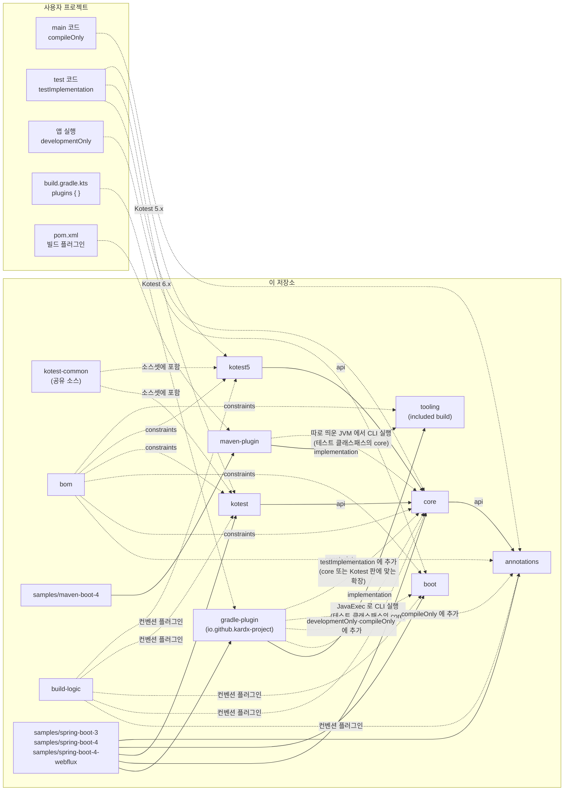
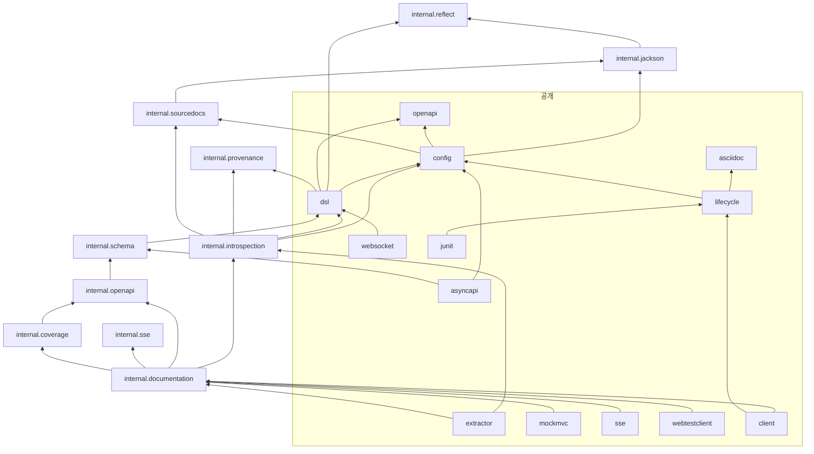

[English](../architecture.md) | **한국어**

# 모듈 구성

이 저장소의 각 모듈이 무엇이고, 무엇이 들어 있고, 서로 어떻게 연결되는지 설명합니다. 처음 저장소를 여는 기여자와, 어느 아티팩트를 의존성에 넣어야 하는지 알고 싶은 사용자를 위한 문서입니다.

사용법은 [docs/](README.md), 빌드·검증 명령은 [개발](development.md) 문서에 있습니다. 여기서는 겹치는 내용을 요약만 하고 링크합니다.

**목차**

- [1. 한눈에 보기](#1-한눈에-보기)
- [2. 의존 관계](#2-의존-관계)
- [3. 사용자는 무엇을 넣나](#3-사용자는-무엇을-넣나)
- [4. 모듈별 설명](#4-모듈별-설명)
  - [annotations](#annotations)
  - [core](#core)
  - [boot](#boot)
  - [kotest](#kotest)
  - [bom](#bom)
  - [gradle-plugin](#gradle-plugin)
  - [tooling](#tooling)
  - [maven-plugin](#maven-plugin)
  - [build-logic](#build-logic)
  - [samples](#samples)
  - [docs 와 scripts](#docs-와-scripts)
- [5. 문서가 만들어지는 흐름](#5-문서가-만들어지는-흐름)
- [6. 빌드 구조](#6-빌드-구조)

## 1. 한눈에 보기

모든 아티팩트의 그룹은 `io.github.kardx-project`, 버전은 `gradle.properties` 의 `version` 하나입니다(현재 `0.1`).

| 디렉터리 | 배포 아티팩트 | 역할 | 누가 쓰나 |
|---|---|---|---|
| `annotations/` | `io.github.kardx-project:kardx-annotations` | DTO·Enum 에 붙이는 `@Description`, `@Masked`, `@EnumCode`, `@AsciiDescription` | 사용자 앱 코드 (`compileOnly`) |
| `core/` | `io.github.kardx-project:kardx` | 라이브러리 본체. DSL, 필드 추출, AsciiDoc·OpenAPI 조각·AsyncAPI 생성 | 사용자 테스트 (`testImplementation`) |
| `boot/` | `io.github.kardx-project:kardx-boot` | 앱이 뜰 때 문서 주소를 INFO 로그로 남김 | 사용자 앱 런타임 (`developmentOnly`) |
| `kotest/` | `io.github.kardx-project:kardx-kotest` | Kotest 6.x 스펙 문서화 확장(`RestDocsExtension`). 리프 테스트마다 스니펫, 스펙마다 AsciiDoc 문서 | Kotest 6.x 를 쓰는 사용자 테스트 (`testImplementation`) |
| `kotest5/` | `io.github.kardx-project:kardx-kotest5` | 같은 확장의 Kotest 5.x 판 (같은 패키지·공개 API). `kotest` 와 함께 넣지 않는다 | Kotest 5.x 를 쓰는 사용자 테스트 (`testImplementation`) |
| `kotest-common/` | 배포 안 함 | `kotest`·`kotest5` 가 함께 컴파일하는 공유 소스·테스트 (Gradle 프로젝트 아님) | 저장소 내부 |
| `tooling/` | `io.github.kardx-project:kardx-tooling` (실행용 `-all` jar 포함) | Gradle API 없는 테스트 다음 단계: OpenAPI 후처리, 스펙 검사, 커버리지, 뷰어, `.http`, Postman, KDoc 스캐너, 내보내기·모으기 도우미, 명령줄 도구 `ApiDocsCli` | Gradle 플러그인, Maven 플러그인, 다른 빌드 (`java -jar`, `exec-maven-plugin`) |
| `bom/` | `io.github.kardx-project:kardx-bom` | 위 여섯 아티팩트의 버전 맞춤 | 사용자 빌드 (`platform(...)`) |
| `gradle-plugin/` | 플러그인 id `io.github.kardx-project` | 라이브러리·테스트 클라이언트 의존성 추가와 문서 파이프라인(index, HTML, OpenAPI, AsyncAPI, 실행 jar) 구성. 선택 기능: 스펙 변경 비교, Redoc·Scalar 뷰어, Postman, 멀티 모듈 집계, WireMock stub jar | 사용자 빌드 (`plugins { }`) |
| `maven-plugin/` | `io.github.kardx-project:kardx-maven-plugin` (목표 접두사 `kardx`) | Maven 판: 목표 `api-docs`(index, AsciiDoc 소스, AsyncAPI, OpenAPI, 뷰어, 커버리지, `.http`, Postman), `check`, `baseline`, `source-docs` | 사용자 POM (`<build><plugins>`) |
| `build-logic/` | 배포 안 함 | 모듈 공통 빌드 설정(`restdocs.*` 컨벤션 플러그인) | 저장소 내부 |
| `samples/spring-boot-3/` | 배포 안 함 | Boot 3.5 예제 앱이자 통합 검증 | 저장소 내부 |
| `samples/spring-boot-4/` | 배포 안 함 | Boot 4.1 예제 앱이자 통합 검증 | 저장소 내부 |
| `samples/spring-boot-4-webflux/` | 배포 안 함 | Boot 4.1 WebFlux 예제 앱 (WebTestClient 문서화 검증) | 저장소 내부 |
| `samples/maven-boot-4/` | 배포 안 함 | Maven 플러그인을 쓰는 Maven 프로젝트 (Java 앱, Kotlin 테스트). Gradle 빌드에 들어가지 않음 | 저장소 내부 |

Gradle 플러그인 본체의 Maven 좌표는 `io.github.kardx-project:kardx-gradle-plugin` 입니다(`gradle-plugin/settings.gradle.kts` 의 프로젝트 이름). 사용자는 보통 플러그인 id 로만 씁니다.

## 2. 의존 관계

실선은 모듈 사이의 빌드 의존, 점선은 사용자 프로젝트에서 들어가는 자리입니다.



- `core` 는 `annotations` 를 `api` 로 노출합니다. 테스트에 `core` 만 넣어도 테스트 코드에서는 어노테이션이 보입니다. 운영 코드(main)에서 쓰려면 `annotations` 를 따로 `compileOnly` 로 넣습니다.
- `kotest` 는 `core` 를 `api` 로 노출하고, Kotest 엔진과 Kotest Spring 확장에는 `compileOnly` 로만 기댑니다. `core` 는 Kotest 에 의존하지 않습니다. 두 확장(JUnit·Kotest)이 함께 쓰는 수명주기는 `core` 의 `lifecycle` 패키지에 있습니다.
- `gradle-plugin` 은 `core` 에 컴파일 의존하지 않습니다. 사용자 테스트 런타임 클래스패스에 있는 `core` 의 CLI(`DocumentationIndexCli`, `AsyncApiCli`)를 `JavaExec` 로 실행합니다.
- `gradle-plugin` 은 Spring Boot 앱이면 자기와 같은 버전의 `boot` 를 `developmentOnly` 에 넣고, IDE 가 설정 메타데이터를 읽도록 `compileOnly` 에도 전이 없이 넣습니다(IntelliJ 는 RUNTIME 범위 의존성의 메타데이터를 읽지 않음).
- `gradle-plugin` 은 자기와 같은 버전의 `annotations`(`compileOnly`)와 `core`(또는 선언한 Kotest 버전에 맞는 `kotest`/`kotest5`, `testImplementation`), 그리고 MVC·WebFlux 판정에 따라 REST Docs·epages 의 MockMvc/WebTestClient 모듈을 넣습니다([자동으로 넣는 의존성](build.md#자동으로-넣는-의존성)).
- `core` 는 `spring-restdocs-mockmvc`·`-webtestclient` 를 `compileOnly` 로만 씁니다. 배포 의존성은 `spring-restdocs-core`·`spring-test` 라서 WebFlux 프로젝트에 서블릿 쪽 의존성이 끌려오지 않습니다.
- `gradle-plugin` 과 `maven-plugin` 에는 빌드 도구 연결만 있습니다. 실제 일(OpenAPI 후처리, 검사, 커버리지, 뷰어, `.http`, KDoc 읽기, 내보내기·모으기)은 `tooling` 에 있어서 두 빌드 도구와 CLI 가 같은 코드를 돌리고 같은 파일을 만듭니다.
- `maven-plugin` 도 `core` 에 컴파일 의존하지 않습니다. `api-docs` 목표가 프로젝트 테스트 클래스패스로 `DocumentationIndexCli`·`AsyncApiCli` 를 따로 띄운 JVM 에서 실행합니다.
- `kotest` 와 `kotest5` 는 같은 Gradle capability(`io.github.kardx-project:kardx-kotest-extension`)를 내보내 둘이 함께 들어오면 Gradle 이 충돌로 알립니다.

## 3. 사용자는 무엇을 넣나

배포 전이라 `./gradlew publishToMavenLocal` 로 설치하고 `mavenLocal()` 을 저장소에 추가합니다. 전체 세팅은 [시작하기](getting-started.md#설치)에 있습니다. 아래는 Boot 4 기준이고, Boot 3 버전은 [Boot 3 에서 다른 점](getting-started.md#boot-3-에서-다른-점)을 봅니다.

**Gradle 플러그인을 쓸 때 (권장)**

플러그인이 라이브러리 아티팩트를 넣으므로 `io.github.kardx-project` 의존성은 적지 않습니다. 앱의 스타터(`-web` / `-webflux`)와 (Kotest 를 쓰면) `io.kotest` 의존성만 적습니다.

```kotlin
plugins {
    id("org.springframework.boot") version "4.1.2"
    id("io.spring.dependency-management") version "1.1.7"
    id("org.asciidoctor.jvm.convert") version "4.0.5"
    id("com.epages.restdocs-api-spec") version "0.20.2"        // OpenAPI 를 만들 때만. Boot 3: 0.19.4
    id("io.github.kardx-project") version "0.1"
}

dependencies {
    implementation("org.springframework.boot:spring-boot-starter-web")
    testImplementation("org.springframework.boot:spring-boot-starter-test")
}
```

| 프로젝트 | 플러그인이 넣는 것 |
|---|---|
| 모두 | `annotations`(`compileOnly`), Spring Boot 앱이면 `boot`(`developmentOnly`) |
| JUnit | `core` |
| Kotest 6.x / 5.x (`io.kotest` 버전을 적었을 때) | `kotest` / `kotest5` (core 를 함께 가져온다) |
| MVC 앱 (`spring-boot-starter-web`·`-websocket`, `spring-webmvc`) | `spring-restdocs-mockmvc`, epages 가 있으면 `restdocs-api-spec-mockmvc` |
| WebFlux 앱 (`spring-boot-starter-webflux`, `spring-webflux`) | `spring-restdocs-webtestclient`, epages 가 있으면 `restdocs-api-spec-webtestclient`. epages 가 끌고 오는 `spring-boot-starter-web` 은 뺀다 |
| 메시지만 (웹 스타터 없음) | `core` 만 (메시지 문서화는 MockMvc 없이 동작) |

OpenAPI 를 Swagger UI 로 보려면 앱의 springdoc 과 `springdoc.swagger-ui.url: /docs/openapi3.yaml` 을 더합니다([application.yml](getting-started.md#4-applicationyml-운영)). 예제는 [samples/spring-boot-4-webflux](../../samples/spring-boot-4-webflux)(WebFlux)와 [samples](../../samples) 입니다. 메시지 문서화 API 와 AsyncAPI 생성기는 `core` 에 있습니다([SSE · WebSocket · AsyncAPI](messaging.md)).

**플러그인 없이 쓸 때**

직접 선언할 의존성은 [플러그인 없이 쓸 때의 의존성](getting-started.md#플러그인-없이-쓸-때의-의존성)에 있습니다. 요약: 운영 코드 `compileOnly` 에 `annotations`, 테스트에 `core`(Kotest 면 판에 맞는 `kotest`/`kotest5` 하나)와 `spring-restdocs-mockmvc` 또는 `-webtestclient`, OpenAPI 면 epages 모듈, 앱 시작 로그를 원하면 `boot`.

```kotlin
dependencies {
    developmentOnly("io.github.kardx-project:kardx-boot:0.1")
    // IntelliJ 가 application.yml 의 kardx.* 키를 알도록 (실행 jar 에는 들어가지 않는다)
    compileOnly("io.github.kardx-project:kardx-boot:0.1") { isTransitive = false }
}
```

**BOM 으로 버전 맞추기**

```kotlin
dependencies {
    val kardx = platform("io.github.kardx-project:kardx-bom:0.1")

    compileOnly(kardx)
    compileOnly("io.github.kardx-project:kardx-annotations")

    testImplementation(kardx)
    testImplementation("io.github.kardx-project:kardx")
    testImplementation("org.springframework.restdocs:spring-restdocs-mockmvc")
}
```

BOM 은 `annotations`, `core`, `boot`, `kotest`, `kotest5` 만 담습니다. Gradle 플러그인 버전은 `plugins { }` 에 따로 적습니다.

## 4. 모듈별 설명

### annotations

**역할.** 사용자 코드(DTO·Enum, 문서화 테스트)에 붙이는 어노테이션만 담습니다. 운영 코드에 테스트 라이브러리(`core`)와 그 의존성(REST Docs 등)이 딸려 오지 않게 하려고 따로 뗐습니다. `compileOnly` 로 넣으면 운영 jar 에 들어가지 않습니다.

**좌표와 의존성.** `io.github.kardx-project:kardx-annotations`. 의존성은 Kotlin stdlib 뿐입니다. `Automatic-Module-Name` 은 `io.github.kardx.annotation` 입니다.

**내용** (패키지 `io.github.kardx.annotation`, 모두 `RUNTIME` 보존)

| 어노테이션 | 쓰임 |
|---|---|
| `@Description(value)` | 필드·파라미터·Enum 상수의 설명 |
| `@EnumCode(value, codeProperty, descriptionProperty)` | `EnumDocumentationExtension` 이 찾아 `Code` / `Description` 표를 만들 Enum 표시 (클래스에만). 비우면 코드는 JSON 값, 설명은 `description` 등 |
| `@Masked(value)` | 값이 마스킹되어 나가는 필드 표시 (문서 표시만, 값은 바꾸지 않음). 필드 표에 `*Masked*: value`, OpenAPI·AsyncAPI 에 `x-masked`·`x-masked-rule` |
| `@AsciiDescription` | 테스트 클래스·메서드에 붙여 생성 AsciiDoc 의 문서·섹션 제목 뒤에 붙는 설명. 테스트 클래스에 붙인 값은 OpenAPI 최상위 `tags` 의 설명(Gradle 플러그인) |

**테스트.** 이 모듈에는 테스트가 없습니다. 어노테이션을 읽는 동작은 `core` 의 테스트가 확인합니다.

**고칠 때 주의할 점**

- `explicitApi()` 가 켜져 있고 공개 API 가 `annotations/api/annotations.api` 로 고정됩니다. 바꾸면 `./gradlew apiDump` 로 갱신합니다.
- 다른 라이브러리에 의존하게 만들지 않습니다. 사용자 운영 코드의 컴파일 클래스패스에 들어가는 모듈입니다.

### core

**역할.** 라이브러리 본체입니다. MockMvc·WebTestClient·RestTestClient 테스트에서 쓰는 Kotlin DSL(`andDocument { }`), 타입에서 필드를 뽑는 추출기, 테스트 클래스별 AsciiDoc 문서 생성, OpenAPI(epages) 연동, SSE·WebSocket·STOMP 메시지 문서화와 AsyncAPI 생성이 들어 있습니다. 사용자 테스트 클래스패스에만 들어갑니다.

**좌표.** `io.github.kardx-project:kardx`. `Automatic-Module-Name` 은 `io.github.kardx` 입니다.

**의존성** (`core/build.gradle.kts`)

| 구분 | 대상 |
|---|---|
| `api` | `annotations`, `kotlin-reflect`, `spring-restdocs-core` (지원 하한 3.0 으로 선언, 실제 버전은 사용자 Boot BOM 이 정함), `spring-test` |
| `compileOnly` | `spring-restdocs-mockmvc`·`jakarta.servlet-api` (MockMvc 진입점), `spring-restdocs-webtestclient`·`spring-webflux` (WebTestClient 진입점), `spring-web`, `spring-websocket`, `spring-context`, `spring-core`, `junit-jupiter-api`, `jakarta.validation-api`, epages `restdocs-api-spec`, `assertj-core` (`MockMvcTester` 진입점) |
| 클래스 이름으로만 찾음 | Jackson 2(`com.fasterxml.jackson.databind.ObjectMapper`)·Jackson 3(`tools.jackson.databind.json.JsonMapper`), yml 로 지정한 설명 어노테이션(Swagger `@Schema` 등). 컴파일 의존이 없습니다 |

`compileOnly` 중 epages 와 Jakarta Validation 은 선택 기능이라 클래스가 있을 때만 씁니다(`internal/reflect/ClassLoading.kt` 의 `loadClassOrNull`). epages 클래스는 `internal/openapi/OpenApiSupport.kt` 안의 별도 객체에서만 참조해, epages 가 없으면 로드되지 않습니다. epages 가 있는지는 본체 클래스(`ResourceDocumentation`)로 판단하므로 `restdocs-api-spec-mockmvc`·`-webtestclient` 어느 쪽이든 됩니다. WebTestClient·MockMvc·`MockMvcTester` 진입점도 그 파일의 함수를 부를 때만 클래스가 로드되므로, 해당 의존성이 없는 프로젝트에서도 나머지는 그대로 동작합니다. 메시지 문서화(`MessageDocumentation`)는 spring-restdocs-core 의 설정기(`RestDocumentationConfigurer`)로 설정 맵을 직접 만들어 MockMvc 없이 동작합니다(`internal/websocket/DocumentationConfigurationMap.kt`). 이 약속은 소스셋 `noServletTest`(`core/src/test/noServlet`, 태스크 `:core:noServletTest`, `check` 에 포함)가 지킵니다: 배포 의존성(`project(":core")`)과 WebFlux·STOMP 쪽만 둔 클래스패스(`spring-restdocs-mockmvc`·`spring-webmvc`·서블릿 API 없음)에서 `mockmvc`·`sse`·`internal` 밖의 공개 클래스를 모두 로드·초기화하고, JUnit 확장 + WebTestClient·메시지 문서화를 실제로 돌립니다.

**RestTestClient 소스셋.** `RestTestClient` 는 Spring Framework 7 에만 있는데 본체 소스셋은 Spring 6·REST Docs 3 으로 컴파일합니다. 그래서 RestTestClient 진입점(패키지 `io.github.kardx.resttestclient`, `core/src/main/restTestClient` 의 파일 6개, 하나는 Java)은 따로 소스셋 `restTestClient` 로 두고, Spring Framework 7·REST Docs 4(`compileOnly`)로 컴파일해 같은 jar·sources jar 에 넣습니다. 클래스는 사용자가 부를 때만 로드되므로 Boot 3 프로젝트는 건드리지 않습니다. `spring-restdocs-core` 의 `RestDocumentationGenerator` 로 `ExchangeResult` 를 직접 변환하므로 `spring-restdocs-resttestclient` 모듈(REST Docs 4.1)은 필요 없습니다. 이 소스셋은 일부러 본체의 friend 로 두지 않습니다: 공개된 클라이언트 어댑터 SPI(`io.github.kardx.client.ClientDocumentation`, [클라이언트 어댑터 SPI](#클라이언트-어댑터-spi))만 쓰므로, 컴파일이 곧 SPI 로 실제 어댑터를 만들 수 있는지 검사가 됩니다. 본체 `internal` 은 테스트(`restTestClientTest`)만 봅니다. 테스트는 `core/src/test/restTestClient` 에 있고 `:core:restTestClientTest`(`check` 에 포함)로 돌며, `apiValidation` 이 이 소스셋의 공개 API 도 `core/api/core.api` 에 남깁니다.

**패키지 원칙.** 최상위 패키지(`io.github.kardx.<이름>`)에는 사용자가 import 하는 것만 두고, 구현은 `io.github.kardx.internal.*` 에 둡니다. `internal` 아래 선언은 Kotlin `internal` 이고, 공개 inline 함수가 부르는 `@PublishedApi` 선언(`internal.jackson` 의 `serializeJson`·`deserializeJson`·`TypeCapture`)만 public 으로 보입니다. 이것들은 사용자 바이너리에 들어가는 ABI 라서 API 덤프에서 빼지 않습니다(`ignoredPackages` 를 쓰지 않음). 패키지 사이 의존에는 순환이 없습니다. `python3 scripts/check-package-cycles.py` 가 확인하고, 루트 태스크 `checkPackageCycles`(`check` 의 일부)가 이를 돌리므로 순환이 있으면 `./gradlew build` 가 실패합니다.

`lifecycle` 패키지는 공개지만 모든 선언에 `@RequiresOptIn` 어노테이션 `@RestDocsExtensionApi` 가 붙어 있어 `@OptIn` 없이 쓰면 컴파일 오류입니다. 다른 모듈(`kotest`)이 Kotlin `internal` 을 볼 수 없어서 공개했고, 테스트 프레임워크 확장을 만드는 사람만 씁니다.

아직 다듬는 중인 공개 API 에는 `@ExperimentalRestDocsApi`(패키지 `io.github.kardx`, 경고 수준의 `@RequiresOptIn`)가 붙어 있습니다: KDoc·Javadoc 설명(`descriptions.sourceDocs`, `DescriptionResolver.SOURCE_DOCS`, `FromParamTag`, 설명 없이 이름만 적는 파라미터 선언), 클라이언트 어댑터 SPI(`client`), 메시징 테스트 도구(`StompTestClient`, `WebSocketHandlerTester`). 다음 릴리스에서 바뀌거나 빠질 수 있고 1.0 의 호환 보장 범위에 들지 않습니다. 사용자는 `@OptIn(ExperimentalRestDocsApi::class)` 를 붙이거나 모듈 전체에 `kotlin { compilerOptions { optIn.add("io.github.kardx.ExperimentalRestDocsApi") } }` 로 켭니다.

설정과 확장의 콜백은 Kotlin 함수 타입이 아니라 `fun interface` 입니다(`DescriptionResolver`, `ValueMasker`, `ObjectMapperProvider`, `PropertyNameStrategy`, `SchemaNameResolver`, `OperationIdResolver`, `DocumentGeneratorFactory`, Kotest `SectionTitleProvider`·`SnippetNameProvider`). 입력(`PropertyContext`, `MaskTarget`, `OperationIdInput`, `DocumentGeneratorContext`, `TestPath` …)은 생성자가 `internal` 이라 라이브러리만 만들므로, 나중에 프로퍼티를 더해도 사용자 코드·바이너리가 깨지지 않습니다.

**공개 패키지**

| 패키지 | 책임 | 대표 클래스·함수 |
|---|---|---|
| `dsl` | 항목 문법과 필드 타입, `andDocument { }`·메시지 블록, 선언한 오류 응답, 항목별 느슨한 검증, 검증 실패 예외, 디스크립터 속성 키 | `"id" pathMeans`, `"name" type STRING`, `DocsFieldType`, `RestDocsField`, `DocumentationBuilder`, `OpenApiBuilder`, `ErrorResponseBuilder`, `DeclaredErrorResponse`, `RelaxedSection`, `MessageDocumentationBuilder`, `MessageDirection`, `DocumentationMismatchException`, `CONSTRAINTS_ATTRIBUTE` |
| `extractor` | 타입에서 필드·파라미터 추출, 블록 안 단축형(`errorResponse { }` 의 `fields<T>()` 포함), 목록 고치기(필드·파라미터), 파라미터 타입, 목록 미리보기 | `responseFieldsOf<T>()`, `requestFieldsOf<T>()`, `parametersOf<T>()`, `wrappedResponseFieldsOf<T>()`, 단축형 `responseFields<T>()`·`requestFields<T>()`·`wrappedResponseFields<T>()`·메시지 `fields<T>()`, `except`, `optionalAt`, `optionalUnder`, `withFields`, `ofType`, `describe()` |
| `mockmvc` | MockMvc 진입점 (`MvcTestResultExtensions.kt` 는 Spring 6.2+ 에서만 로드) | `ResultActions`·`ResultActionsDsl`·`MvcTestResult` `.andDocument`, `restDocsMockMvc`, `jsonContent`, `bearerToken`, `performAsync` |
| `webtestclient` | WebTestClient 진입점과 설정 헬퍼 (`spring-restdocs-webtestclient`·`spring-webflux` 가 있을 때만 로드) | `ResponseSpec`·`BodyContentSpec`·`BodySpec.andDocument`, `restDocsWebTestClient`, `WebTestClient.Builder.restDocs`, `MockServerSpec.recordHandlers` |
| `sse` | 끝나지 않는 SSE 스트림 받기 (이벤트 항목 문법 `events(...)` 는 `dsl`) | `MockMvc.performStream` |
| `websocket` | WebSocket·STOMP 메시지 문서화, 핸들러 테스트, 테스트용 STOMP 클라이언트 | `MessageDocumentation`, `WebSocketHandlerTester`, `StompTestClient`, `StompSubscription`, `StompFrame` |
| `config` | 전역 설정, yml 설정, 응답 래퍼, 설명 어노테이션, 생성 문서의 스니펫 종류·섹션 순서, 문서 언어 | `RestDocsConfiguration`, `RestDocsSettings`, `DocsLanguage`, `ResponseWrapper`, `DescriptionAnnotation`, `DescriptionResolver`, `ValueMasker`, `MaskTarget`, `SnippetFile`, `DocumentSectionOrder` |
| `junit` | JUnit 5 확장. 테스트 클래스를 리플렉션으로 읽어 문서 구조(`DocumentOutline`)를 만들고 수명주기는 `lifecycle` 에 맡긴다 | `AutoRestDocumentationExtension`, `EnumDocumentationExtension` (`JUnitDocumentOutline` 은 internal) |
| `lifecycle` | 테스트 프레임워크와 무관한 문서화 수명주기와 문서 구조 모델. 확장 제작용 opt-in API(`@RestDocsExtensionApi`, 일반 테스트 코드에서 쓰지 않음). JUnit·Kotest 확장이 함께 쓴다 | `DocumentationLifecycle`, `DocumentationRun`, `DocumentOutline`, `DocumentSection`, `SpringContextSettings`, `EnumCodeDocumentation` (`AsciiDocumentWriter` 는 internal) |
| `asciidoc` | AsciiDoc 문서 모양, Enum 코드 문서 형식, 문서 index, index CLI | `DocumentGenerator`, `DocumentGeneratorFactory`, `EnumDocumentFormat`, `AsciiDocEnumDocumentFormat`, `DocumentationIndex`, CLI `DocumentationIndexCli` |
| `openapi` | OpenAPI 스키마 이름, operationId 규칙 | `SchemaNames`, `OperationIdRule`, `OperationIdInput`, `SchemaNameResolver`, `OperationIdResolver` |
| `asyncapi` | AsyncAPI 3.0 문서와 뷰어 생성, 인증 방식, CLI | `AsyncApiGenerator`, `AsyncApiInfo`, `AsyncApiServer`, `AsyncApiSecurityScheme`, `AsyncApiSecurityType`, `AsyncApiApiKeyLocation`, CLI `AsyncApiCli` |
| `client` | 다른 HTTP 테스트 클라이언트를 문서화하는 클라이언트 어댑터 SPI (`@RestDocsExtensionApi` + `@ExperimentalRestDocsApi`) | `ClientDocumentation` |
| `resttestclient` | RestTestClient 진입점 (Spring Framework 7 전용, 별도 소스셋, 위 참고). `client` 위에 만들어져 있다 | `ResponseSpec`·`BodyContentSpec`·`BodySpec.andDocument`, `RestTestClient.Builder.restDocs` |

**내부 패키지** (`io.github.kardx.internal.*`)

| 패키지 | 책임 |
|---|---|
| `reflect` | 클래스 로딩, 클래스패스 스캔, 어노테이션 값 읽기, Enum 의 JSON 값·프로퍼티 읽기, 선언 필드 순서, 메서드와 첫 파라미터의 어노테이션, 인터페이스 위임 프록시(`GetterOverride`). 이 저장소의 다른 패키지에 기대지 않습니다 |
| `jackson` | Jackson 2·3 매퍼 찾기와 직렬화, 제네릭 타입 캡처 |
| `http` | Spring 6·7 `HttpHeaders` 차이 흡수, 상태 문구(`409 Conflict`), 민감 헤더 값 가리기, 글자가 아닌 본문을 `<binary: N bytes>` 로 바꾸기(Content-Type 으로 글자 판단), 파일 본문 정보(`FileBody`: charset 뺀 미디어 타입, 파일 이름, 원래 크기), MockMvc 응답 본문을 타입으로 바꾸기(`andReturnAsObject`·`andReturnEntity` 공통 규칙) |
| `output` | 생성물의 위치·이름·순서(테스트 → 문서·스니펫 경로, `@DisplayName`(JUnit·Kotest), JUnit 순서, `@AsciiDescription`)와 원자적 파일 쓰기, 실행 중인 테스트의 문서 정보(`RunningTest`, Kotest 확장이 코루틴에 묶음), OpenAPI·AsyncAPI 태그·요약(`OperationTitles`), 클래스별 문서 기록(`DocumentRecord`: index 항목과 헤더 가리기 여부, `.restdocs-documents/`) |
| `introspection` | 타입 분석과 필드 추출(프로퍼티, `errorResponse` 예시 객체의 필드(`ExampleFields`), Jackson 이름 규칙, sealed·Spring Data·ProblemDetail, Bean Validation 제약, 타입·제약 스키마 조각). 타입 처리는 일별로 나뉩니다: `Optional`·value class·`@JsonValue` 풀기(`Unwrapped.kt`), 제네릭 타입 파라미터 바인딩(`TypeBindings.kt`), Java `Type` → `KType`(`JavaTypes.kt`) |
| `schema` | 필드 목록으로 JSON Schema 만들기 (AsyncAPI 페이로드, multipart 파트) |
| `diagnostics` | 검증 실패(누락·초과, 필드 타입 불일치)를 경로 목록·DSL 제안·원인 힌트가 담긴 메시지로 감싸기 |
| `openapi` | epages 리소스 스니펫, relaxed 파라미터 항목(`RelaxedParameters`), 보안 스키마(헤더 없이 선언한 `bearerAuth()`·`basicAuth()` 포함), 전역 헤더, 스키마 이름 출처, `openapi-extras.json`, operationId 후보(요청을 처리한 핸들러 기록, 규칙별 이름), 핸들러 인자 타입(`HandlerParameters`)·`@Deprecated`(`HandlerDeprecation`) 읽기, 문서화하지 않은 경로 변수 경고(`UndocumentedPathVariables`) |
| `asyncapi` | AsyncAPI 기록(`*.asyncapi.json`) 쓰기·읽기, 메시지 스키마, YAML 쓰기, 뷰어(인라인하는 CSS·JS 에서 주석 빼기: `WebComments`, `CommentScanner`) |
| `websocket` | 메시지를 REST Docs 요청으로 바꾸기, 메시지 스니펫, 녹화 WebSocket 세션, `StompTestClient` 가 쓰는 페이로드 글·원문 STOMP 변환기(`PayloadText`, `RawTextMessageConverter`, `StompSubscriptionCancel`), MockMvc 없이 REST Docs 설정 맵 만들기(`DocumentationConfigurationMap`) |
| `sse` | SSE 본문 파싱, 이벤트 표·이벤트 `data` 필드 스니펫과 AsyncAPI 기록 |
| `documentation` | `andDocument` 실행: 블록 → 스펙 → 스니펫 목록, 선언한 오류 응답(`ErrorResponsesSnippet`, 예시 검사 `ErrorExampleCheck`·`ErrorResponseExamples`, 받은 상태 빼기 `ReceivedErrorResponse`), 파일 본문 표(`FileBodySnippet`)와 바이너리 본문의 언어 없는 `[source]` 블록(`BinaryBodyBlocks`), 블록에서 정하지 않은 파라미터 타입·deprecated 를 핸들러에서 채우기(`HandlerDefaults`), 전처리, api-summary·WireMock 스니펫, 스트림 고정(`StreamSnapshot`), 목록 미리보기 표 |
| `asciidoc` | 스니펫 파일 고르기(`SnippetFileListExtractor`), Enum 코드 문서 쓰기. 클래스별 문서 쓰기(`AsciiDocumentWriter`)는 `lifecycle` 에 있다 |
| `i18n` | 생성 문서·스펙에 넣는 문구의 언어별 목록과 언어 불일치 경고. `DocsText`(index 제목·링크, 스키마 설명 접두사, Spring Data·`ProblemDetail`·sealed 자동 설명, AsyncAPI 채널 설명, 파일 본문 표 머리글), `LocalizedText`(캐시에 오래 남는 설명을 쓰는 시점의 언어로 고른다), `ViewerText`(AsyncAPI 뷰어 화면 문구. 고른 언어의 것만 페이지에 JSON 으로 넣는다), `PluginLanguageWarning`(문서 언어가 Gradle 플러그인이 테스트 JVM 에 넘긴 언어와 다르면 `io.github.kardx.config` 로거에 JVM 마다 한 번 WARN. 플러그인 없이는 경고하지 않는다). 한국어 문구는 언어 설정 전의 출력과 같다. 로그·예외 메시지는 여기에 두지 않고 영어로 쓴다 |
| `sourcedocs` | Gradle 플러그인의 `apiDocsSourceDocs` 가 쓴 KDoc/Javadoc 색인 읽기(`SourceDocs`, `SourceDocsIndex`). 설명의 마지막 출처 |
| `coverage` | 문서화 커버리지용 엔드포인트 목록: 앱 컨텍스트가 매핑한 엔드포인트(`EndpointInventory`, `MappedEndpoint`, `MappedEndpoints`)를 `apiDocsCoverage` 가 읽도록 `.kardx/endpoints/` 에 씀 |
| `provenance` | 추출한 필드의 출처(`FieldOrigin`, `FieldSource`). 필드가 들고 다녀 목록을 고쳐도 스키마 이름 기본값이 남음. 저장소의 다른 패키지에 기대지 않으므로 `dsl` 과 `internal.introspection` 이 서로 기대지 않음 |
| `spring` | Spring 앱 컨텍스트·`Environment` 에서 설정과 ObjectMapper 읽기, 모르는 `kardx.*` 키 경고(`UnknownPropertyWarnings`, 키 대조는 `PropertyKeys`) |

공개 패키지에 Kotlin `internal` 로 남긴 구현은 공개 타입과 서로 부르는 것뿐입니다. 떼어 내면 패키지 순환이 생깁니다: `config` 의 `ExternalSettings`(yml → `RestDocsSettings`)·`DescriptionResolvers`(기본 설명 단계), `asyncapi` 의 `AsyncApiDocumentBuilder`(`AsyncApiInfo` 를 읽음)·`AsyncApiSecuritySchemes` 와 CLI, `asciidoc` 의 index CLI, `dsl` 의 `ParameterSection`·`DocsFieldType` 변환 함수와 디스크립터 속성 키(`DescriptorAttributes.kt`, 공개 상수 `CONSTRAINTS_ATTRIBUTE` 옆의 `internal` 상수. Gradle 플러그인과의 문자열 약속).

`internal.documentation` 의 `StreamSnapshot`(끝나지 않는 스트림 고정)은 `internal.sse` 가 아니라 `internal.documentation` 에 둡니다. 결과 타입 `StreamResultActions` 가 `MvcResultActions` 를 상속하고, `internal.documentation` 이 SSE 스니펫(`internal.sse`)을 쓰므로 옮기면 순환이 생깁니다.

**계층** (아래가 먼저. 화살표는 "의존한다". 같은 줄은 서로 의존하지 않음)

```
L9  client   extractor   mockmvc   sse   webtestclient   (resttestclient, 별도 소스셋)
L8  junit   internal.documentation
L7  asyncapi   lifecycle   websocket   internal.coverage   internal.sse
L6  internal.asciidoc   internal.asyncapi   internal.diagnostics   internal.openapi
L5  asciidoc   internal.introspection   internal.schema   internal.spring   internal.websocket
L4  dsl   internal.http   internal.i18n   internal.output
L3  config
L2  internal.sourcedocs
L1  internal.jackson
L0  openapi   internal.provenance   internal.reflect
```



그림은 큰 흐름만 보입니다. 전체 간선은 `python3 scripts/check-package-cycles.py --graph core/src/main/kotlin` 이 출력합니다.

CLI 두 개(`io.github.kardx.asciidoc.DocumentationIndexCli`, `io.github.kardx.asyncapi.AsyncApiCli`)는 `@file:JvmName` 으로 이름을 고정한 `internal fun main` 입니다. 공개 API 는 아니지만 JVM 클래스 이름과 명령행 옵션은 Gradle 플러그인과의 약속입니다. 그 밖의 최상위 함수(`extractor` 패키지 포함)는 `@file:JvmName` 을 쓰지 않고 Kotlin 기본 파일 클래스(`…Kt`)에 들어갑니다. DSL 은 Kotlin 에서만 쓰므로 Kotlin 사용자에게는 보이지 않는 이름입니다.

**리소스** (`core/src/main/resources`)

- `org/springframework/restdocs/templates/asciidoctor/*.snippet`: REST Docs 기본 템플릿을 덮어쓰는 스니펫 템플릿 17개(`request-fields`, `api-summary`, `error-responses`, `file-body`, `message`, `sse-events` 등. 일부는 라이브러리 자체 스니펫). `templates/markdown/` 에도 `api-summary`, `error-responses`, `file-body`, `message`, `sse-events` 가 있습니다. 경로는 REST Docs 가 정하므로 라이브러리 패키지와 상관없습니다.
- `io/github/kardx/internal/asyncapi/viewer.html`·`viewer.css`·`viewer.js`: AsyncAPI 뷰어. `AsyncApiViewer` 가 자기 패키지 기준으로 읽어 CSS·JS 를 HTML 안에 넣어 파일 하나로 만듭니다(클래스를 옮기면 함께 옮깁니다).
- `META-INF/spring-configuration-metadata.json`: IDE 가 `kardx.*` 테스트 설정을 자동 완성하는 메타데이터. 소스 원본은 `src/main/resources/META-INF/additional-spring-configuration-metadata.json` 하나이고, 빌드(`processResources`)가 표준 이름으로 바꿔 jar 에 넣습니다. `sourceType`·`type` 에 `config` 의 클래스 이름이 들어 있습니다.
- `core/Module.md`: Dokka(javadoc jar)의 모듈 설명.

**테스트.** `core/src/test` 에 Kotest `BehaviorSpec` 테스트가 대상과 같은 패키지에 있고, 추출기 검사용 Java 클래스가 `src/test/java` 의 `extractor` 에 있습니다. `io.kotest.provided.ProjectConfig` 가 매 테스트 뒤 `RestDocsConfiguration` 을 되돌립니다. 실행은 `./gradlew :core:test` 입니다. 눈여겨볼 계약 테스트:

- `ConfigurationMetadataTest`: 메타데이터 JSON 이 지원하는 속성과 `RestDocsSettings` 기본값을 빠짐없이 담는지
- `PublicValueClassesTest`: 공개 값 클래스의 `equals`/`hashCode`/`toString`
- `CliEntryPointTest`: Gradle 플러그인이 실행하는 CLI 클래스에 `main` 이 있는지
- `JacksonCompatibilityTest`: `@JsonProperty`, `@JsonTypeInfo`, `JsonNode` 같은 Jackson 쪽 형태의 추출

**고칠 때 주의할 점**

- Spring REST Docs 3.0 / Spring Framework 6 API 로 컴파일하고, REST Docs 4.0 / Spring 7 과 바이너리 호환을 유지합니다. 호환은 `samples/spring-boot-4` 가 검증합니다. 버전마다 다른 API 는 리플렉션으로 맞추고(`internal.http`, `internal.reflect`, `internal.openapi`) 한곳에 모읍니다.
- Jackson 클래스를 직접 import 하지 않습니다. Jackson 2·3 를 모두 지원하려고 클래스 이름으로 찾습니다(`internal/jackson/DefaultObjectMapper.kt`).
- 새 파일은 패키지 원칙을 따릅니다. 사용자가 import 하지 않는 것은 `internal.*` 에 두고, 넣은 뒤 `python3 scripts/check-package-cycles.py` 로 순환이 없는지 봅니다.
- 공개 API 는 `explicitApi()` 와 `core/api/core.api` 로 관리합니다. 바꾸면 `./gradlew apiDump`, `check` 가 `apiCheck` 로 검사합니다. 공개 API 에 data class 를 두지 않는 규칙과 생성자 호환 방법은 [개발](development.md) 문서에 있습니다.
- Gradle 플러그인과 문자열로 맞물린 값이 있습니다. 한쪽을 바꾸면 다른 쪽도 바꿉니다.
  - CLI 클래스 이름(`io.github.kardx.asciidoc.DocumentationIndexCli`, `io.github.kardx.asyncapi.AsyncApiCli`)과 옵션 ↔ 플러그인 `IndexTasks`, `AsyncApiTasks`, core `CliEntryPointTest`
  - `AsyncApiMetadata.FILE_SUFFIX`(`.asyncapi.json`) ↔ `AsyncApiTasks` 의 `**/*.asyncapi.json`
  - `internal/openapi/OpenApiGlobalHeaders.FILE_NAME` ↔ 플러그인 `OpenApiGlobalHeaders.SETTINGS_FILE`
  - `internal/openapi/OpenApiOperationExtras.FILE_NAME`(`openapi-extras.json`)·키 이름 ↔ 플러그인 `OpenApiResources.EXTRAS_FILE`, `OpenApiRequestExtras`, `OpenApiFileBodies`
  - 디스크립터 속성 키(`dsl/DescriptorAttributes.kt` 의 `schema`, `constraintNote`, `requiredByConstraint`, `requiredInParent`, `nullable`, `nullableItems`, `default`, `example`) ↔ 플러그인 `DescriptorHints`
  - 시스템 속성 `kardx.snippets.directory`, `kardx.asciidoc-directory` ↔ `TestTaskSetup`
- yml 설정을 추가하면 `META-INF/additional-spring-configuration-metadata.json` 도 고칩니다(`ConfigurationMetadataTest` 가 잡습니다).

#### 클라이언트 어댑터 SPI

`andDocument` 가 하는 문서화(블록 → 스니펫, OpenAPI 조각, WireMock 매핑. 설정의 가리기·전처리기 포함)는 `io.github.kardx.client.ClientDocumentation` 으로 다른 HTTP 테스트 클라이언트(Ktor, RestAssured …)에도 붙일 수 있습니다. 라이브러리의 RestTestClient 어댑터가 이 API 만으로 만들어져 있습니다. `@OptIn(RestDocsExtensionApi::class)` 와 `@OptIn(ExperimentalRestDocsApi::class)` 가 모두 필요합니다. 어댑터는 두 가지를 합니다.

1. 요청을 보내기 전(또는 클라이언트 인터셉터에서) `ClientDocumentation.configuration(provider)` 를 부릅니다. 이 요청의 REST Docs 설정 맵(문맥, 템플릿 엔진, 기본 HTTP 스니펫)을 돌려주고 문맥의 순번을 하나 올리므로, 요청마다 정확히 한 번 부릅니다.
2. 응답을 받으면 그 맵과, 클라이언트의 요청·응답을 REST Docs `OperationRequest`·`OperationResponse` 로 바꾸는 변환기를 넘겨 `ClientDocumentation.document(...)` 를 부릅니다.

```kotlin
@OptIn(RestDocsExtensionApi::class, ExperimentalRestDocsApi::class)
fun HttpResponse.andDocument(block: DocumentationBuilder.() -> Unit) {
    ClientDocumentation.document(
        exchange = this,
        requestConverter = KtorRequestConverter,       // HttpResponse -> OperationRequest
        responseConverter = KtorResponseConverter,     // HttpResponse -> OperationResponse
        configuration = call.attributes[RestDocsConfigurationKey], // 보내기 전에 ClientDocumentation.configuration(provider) 로 만든 맵
        status = status.value,
        urlTemplate = call.attributes.getOrNull(UrlTemplateKey),
        block = block,
    )
}
```

| 인자 | 용도 |
|---|---|
| `exchange`, `requestConverter`, `responseConverter` | 클라이언트의 교환과, 그것을 받는 변환기 |
| `configuration` | 이 요청에 대해 `configuration(provider)` 로 만든 맵 |
| `status` | 응답 상태 코드. 오류 응답 스키마 이름과 선언한 `errorResponse` 에 쓴다 |
| `urlTemplate` | 요청 URL 템플릿(`/users/{id}`). 없으면 경로 파라미터를 문서화할 수 없다 |
| `handler` | 요청을 처리한 Spring `HandlerMethod`(알 때). operationId 와 파라미터 타입 기본값에 쓴다 |
| `rawResponseBody` | 전처리 전의 응답 본문. 바이너리 본문의 WireMock 매핑에 쓴다 |
| `applicationContext` | 요청을 처리한 앱 컨텍스트. 문서화 커버리지의 엔드포인트 목록에 쓴다 |
| `block` | `andDocument { }` 블록 |

`ClientDocumentation.DOCUMENT_IDENTIFIER` 는 스니펫 디렉터리를 정하는 REST Docs 문서 식별자(`{class-name}/{method-name}`)입니다. 어댑터가 같은 REST Docs 문맥을 쓰므로 JUnit·Kotest 확장은 그대로 동작합니다.

### boot

**역할.** Spring Boot 앱이 뜰 때 REST Docs, Swagger UI, OpenAPI, AsyncAPI 주소를 INFO 로그로 남깁니다. `core` 는 테스트 전용이고 이 기능은 앱 런타임에 필요해서 따로 뗐습니다. 기본으로 `developmentOnly` 에 들어가 IDE 실행과 `bootRun` 에서만 동작합니다.

**좌표와 의존성.** `io.github.kardx-project:kardx-boot`. `spring-boot`(3.5 버전)와 `spring-core` 를 `compileOnly` 로만 씁니다. Boot 는 사용자 앱이 가져옵니다. `Automatic-Module-Name` 은 `io.github.kardx.boot` 입니다.

**내용** (패키지 `io.github.kardx.boot`)

| 클래스 | 공개 | 내용 |
|---|---|---|
| `ApiDocsStartupLogger` | 예 | `ApplicationReadyEvent` 리스너. 컨텍스트당 한 번 로그를 남깁니다. springdoc UI 클래스가 있을 때만 Swagger UI 줄을 넣습니다 |
| `StartupLogLanguage`, `StartupLogText` | 아니오 | 시작 로그 문구의 언어와 언어별 기본 문구. 언어는 앱 설정 `kardx.language`, 없으면 플러그인이 `docs-locations.properties` 에 남긴 `language`, 그것도 없으면 `en` 입니다. 지원하지 않는 값이면 경고 한 번 남기고 영어로 씁니다(문서 설정의 오타로 앱이 뜨지 못하면 안 되므로). boot 는 core 에 의존하지 않아 core 의 `DocsLanguage` 를 쓰지 않습니다 |
| `ApiDocsLocations` | 아니오 | Gradle 플러그인이 남긴 `META-INF/kardx/docs-locations.properties`(문서 경로·파일 이름 기본값, yml 이 먼저), 앱 설정(포트, `server.servlet.context-path` 또는 WebFlux 앱의 `spring.webflux.base-path`, `spring.mvc.servlet.path`, `server.ssl.enabled`, `springdoc.swagger-ui.path`)과 정적 리소스로 주소를 계산합니다. 실제로 있는 문서만 보여 줍니다 |

**리소스**

- `META-INF/spring.factories`: `ApiDocsStartupLogger` 를 `ApplicationListener` 로 등록합니다. 의존성만 있으면 동작합니다.
- `META-INF/spring-configuration-metadata.json`(소스는 `additional-spring-configuration-metadata.json`): `kardx.docs-path`, `kardx.startup-log.*` 자동 완성.

**테스트.** `ApiDocsLocationsTest`(Kotest). `./gradlew :boot:test`.

**고칠 때 주의할 점**

- Boot 3 API 로 컴파일하고 Boot 4 와 바이너리 호환을 유지합니다. 샘플은 이 모듈을 Gradle 플러그인이 넣는 대로(`developmentOnly`, IDE 메타데이터용 `compileOnly`) 씁니다. 저장소 안에서는 그 배포 좌표가 이 프로젝트로 바뀝니다([samples](#samples)의 의존성).
- 공개 API 는 `boot/api/boot.api` 로 고정됩니다.
- 설정 키를 바꾸면 메타데이터 JSON 과 [앱 시작 로그](build.md#앱-시작-로그) 문서를 함께 고칩니다.
- Gradle 플러그인은 사용자가 이 모듈을 직접 선언했는지 이름(`kardx-boot` 또는 같은 빌드의 `boot`)으로 확인합니다.

### kotest

**역할.** Kotest 스펙(`BehaviorSpec`, `FunSpec`, `DescribeSpec` 등)을 문서화하는 확장입니다. JUnit 확장과 같은 일을 같은 코드(`core` 의 `lifecycle`)로 합니다. 사용법은 [Kotest](kotest.md) 에 있습니다.

같은 확장이 Kotest 버전마다 두 모듈입니다: `kotest`(6.x, `kardx-kotest`)와 `kotest5`(5.x, `kardx-kotest5`). 패키지·공개 API 가 같아 사용자는 좌표만 고릅니다. 버전과 상관없는 코드와 테스트는 `kotest-common/src/{main,test}/kotlin` 에 한 벌 두고 컨벤션 플러그인 `restdocs.kotest-module` 이 두 모듈의 소스셋에 넣습니다(배포 안 함). 각 모듈에는 Kotest API 에 닿는 어댑터만 있습니다([개발: 공유 소스](development.md)).

**좌표와 의존성.** `io.github.kardx-project:kardx-kotest`, `io.github.kardx-project:kardx-kotest5`. 두 jar 의 `Automatic-Module-Name` 은 패키지와 같은 `io.github.kardx.kotest` 입니다(함께 들어오지 않으므로 겹치지 않음).

| 구분 | 대상 |
|---|---|
| `api` | `core` |
| `compileOnly` | 6.x: `kotest-framework-engine`, `io.kotest:kotest-extensions-spring`. 5.x: `kotest-framework-api`, `io.kotest.extensions:kotest-extensions-spring`. 둘 다 `spring-test`, `spring-core`, `spring-context` |
| 클래스 이름으로만 찾음 | Kotest Spring 확장(`io.kotest.extensions.spring.SpringTestContextCoroutineContextElement`). 없으면 Spring 연동 없이 동작 |
| Gradle capability | 기본 capability 에 더해 두 모듈 모두 `io.github.kardx-project:kardx-kotest-extension` (함께 들어오면 충돌). Maven POM 으로는 전달되지 않음 |

**내용** (패키지 `io.github.kardx.kotest`)

| 파일 (위치) | 공개 | 하는 일 |
|---|---|---|
| `RestDocsExtension` (모듈마다) | 예 | `TestCaseExtension`·`BeforeInvocationListener`·`AfterSpecListener` 구현. Kotest 의 테스트·결과를 읽어 `LeafTestDocumentation` 에 넘깁니다. `provider`, `currentTestProvider` |
| `KotestLine` (공유) | 아니오 | 모듈이 컴파일된 Kotest 판(5.x·6.x)과 판별 클래스. `RestDocsExtension` 을 만들 때 클래스패스의 Kotest 판이 다르면 바꿀 아티팩트를 알리고 실패합니다 |
| `KotestTestCases` (모듈마다) | 아니오 | 테스트 이름 경로(6.x `name.name`, 5.x `name.testName`)와 리프 판정(6.x `TestType.Test`, 5.x 는 `Dynamic` 도) |
| `LeafTestDocumentation` (공유) | 아니오 | 리프 테스트를 감싸 수명주기를 돌리고(본문 직전에 문서 설정 기억), 그 스펙을 문서화한 확장이면 스펙 인스턴스가 끝날 때 문서를 씁니다. Kotest 타입을 참조하지 않습니다 |
| `TestOutcome` (공유) | 아니오 | 결과의 실패·성공 판정 (결과 없음은 실패) |
| `TestNames` (공유) | 예 | 섹션 제목·스니펫 자리 이름 기본 규칙(`sectionTitle`, `snippetName`, `slug`) |
| `SectionTitleProvider`, `SnippetNameProvider`, `TestPath` (공유) | 예 | `RestDocsExtension` 의 `sectionTitle`·`snippetName` 인자(fun interface)와 그 입력(테스트 이름 경로, spec 클래스). 각 `DEFAULT` 는 `TestNames` 를 쓴다 |
| `EnumDocumentationExtension` (공유) | 예 | `BeforeSpecListener`. `@EnumCode` 문서를 JVM 에서 한 번 씁니다. 5.x·6.x 의 `BeforeSpecListener`·`Spec` 이 같은 이름·시그니처라 소스 하나로 둡니다 |
| `ActiveRun` (공유) | 아니오 | 실행 중인 리프 테스트와 그것을 코루틴에 묶는 `ThreadContextElement` (스레드가 바뀌어도 provider 가 지금 테스트를 찾음) |
| `SpecDocument` (공유) | 아니오 | 스펙 클래스별 섹션 기록(첫 실행 순서, 이름 겹침 번호와 경고). 격리 모드의 여러 스펙 인스턴스가 한곳에 모읍니다 |
| `SpringContexts` (공유) | 아니오 | Kotest Spring 확장의 코루틴 문맥에서 `ApplicationContext` 찾기 (클래스가 없으면 null). 5.x·6.x Spring 확장의 문맥 요소가 같은 이름이라 소스 하나로 둡니다 |

**테스트.** 공유 테스트 `kotest-common/src/test` 의 `RestDocsExtensionTest` 가 고정 스펙(`fixture/StyleFixtures.kt`, 격리 모드별 `fixture/IsolationFixtures.kt`, `@EnabledIf(LaunchedOnly)` 라 Gradle 이 직접 돌리지 않음)을 Kotest 엔진(`TestEngineLauncher`)으로 실행해 문서·스니펫을 확인합니다. 같은 테스트가 두 모듈에서 각 Kotest 버전 엔진으로 돕니다. 버전별 부분(런처, `LaunchedOnly`, 6.x 의 `InstancePerRoot`, 5.x 의 `withData`·`extensions()` 등록)은 각 모듈의 `KotestVersionFixtures.kt`·`KotestSixOnlyTest`·`KotestFiveOnlyTest` 에 있습니다. 테스트 클래스패스에 Kotest Spring 확장이 없으므로 Spring 없이 도는 경로도 함께 검증합니다. `./gradlew :kotest:test :kotest5:test`.

**고칠 때 주의할 점**

- `kotest` 는 Kotest 6.x API(`io.kotest.engine.test.TestResult`, `TestName.name`), `kotest5` 는 5.x API(`io.kotest.core.test.TestResult`, `TestName.testName`)로 컴파일합니다. 서로 바이너리 호환이 되지 않으므로 Kotest API 를 새로 쓰면 두 모듈의 어댑터에 각각 넣고, 버전과 상관없는 로직은 `kotest-common` 에 둡니다.
- `core` 의 Kotlin `internal` 은 보이지 않습니다. 필요한 것은 `core` 의 `lifecycle` 에 opt-in 공개 API 로 둡니다.
- 공개 API 는 `explicitApi()` 와 `kotest/api/kotest.api`·`kotest5/api/kotest5.api` 로 고정됩니다. 두 덤프는 5.x 리스너의 `getName()` 말고는 같아야 합니다.

### bom

**역할.** `annotations`, `core`, `boot`, `kotest`, `kotest5`, `tooling` 의 버전을 한 줄로 맞추는 BOM 입니다. `java-platform` 플러그인으로 만들고 `dependencies { constraints { } }` 만 있습니다.

**좌표.** `io.github.kardx-project:kardx-bom`.

**고칠 때 주의할 점.** 배포 모듈을 새로 만들면 `bom/build.gradle.kts` 의 `constraints` 에 추가합니다. Gradle·Maven 플러그인은 BOM 에 없습니다(의존성이 아니라 빌드 플러그인이므로).

### gradle-plugin

**역할.** 사용자 프로젝트의 문서 파이프라인을 구성하는 Gradle 플러그인(`id("io.github.kardx-project")`)입니다. 라이브러리·테스트 클라이언트 의존성 추가, 테스트 실행 설정, index·Asciidoctor 입력 준비, OpenAPI 후처리(`tooling` 을 통해), AsyncAPI 생성, 결과 모으기, 실행 jar 포함, 시작 로그 모듈 추가를 맡습니다. 다른 플러그인(Asciidoctor, epages, Spring Boot)은 적용하지 않고, 적용돼 있을 때만 연결합니다. 사용 설명은 [Gradle 플러그인](build.md#gradle-플러그인)에 있습니다.

**왜 따로 떨어져 있나.** 루트 빌드의 하위 프로젝트가 아니라 composite build(`includeBuild("gradle-plugin")`)입니다. 샘플이 배포 없이 바로 플러그인을 쓰게 하려는 것입니다. Gradle 이 Kotlin 런타임을 내장하므로 stdlib 충돌을 피하려고 Java 17 로 작성합니다.

**좌표와 의존성.** 플러그인 id `io.github.kardx-project`, 구현 클래스 `io.github.kardx.gradle.KardxPlugin`. 런타임 의존성은 `kardx-tooling`(included build, 좌표 치환) 하나이고 `snakeyaml` 은 이것이 가져옵니다. tooling 의 `groovy-json` 은 빼므로 JSON 은 Gradle 이 내장한 Groovy `JsonSlurper` 로 읽습니다. 태스크 액션은 `tooling` 의 단계(`internal.steps`)를 부르고 Gradle 전용 안내(`./gradlew apiDocsBaseline` 등)를 인자로 넘깁니다. 로그는 `gradle.internal.GradleToolLog` 를 거쳐 태스크 로거로 갑니다. Asciidoctor·epages·Spring Boot 플러그인 클래스는 컴파일 의존 없이 리플렉션(`Reflection`)으로 부릅니다.

**태스크** (이름은 모두 `apiDocs` 로 시작. 직접 실행하는 태스크는 그룹 `documentation`, 중간 단계인 `apiDocsAsciidocSources`·`apiDocsOpenApiSnippets`·`apiDocsAppDocs`·`apiDocsPublicationSpecs` 는 그룹 없음)

| 태스크 | 하는 일 | 입력 → 출력 |
|---|---|---|
| `test` (설정만) | 스니펫·AsciiDoc 경로를 시스템 속성으로 넘기고, 실행 전에 지난 결과를 지웁니다 | 테스트 → `build/generated-snippets`, `build/generated-asciidoc` |
| `apiDocsSourceDocs` | 실험 기능이며 기본으로 꺼져 있습니다. `sourceDocs { enabled = true }` 일 때만 `test` 전에 돕니다(아니면 `test` 가 의존하지 않고 직접 실행해도 건너뜀). 이 프로젝트와 `project(...)` 의존 프로젝트의 `main` 소스에서 KDoc·Javadoc 을 읽습니다(`SourceDocsTask`, `internal.sourcedocs`). `test` 는 파일 경로를 시스템 속성으로 받습니다 | Kotlin·Java 소스 → `build/kardx/source-docs/source-docs.json` |
| `apiDocsIndex` | `DocumentationIndexCli` 를 실행해 index 를 만듭니다. 설정이 없으면 테스트가 남긴 문서 기록으로 문서를 만든 모든 클래스를, `index.packageName`·`baseClass` 를 함께 정하면 그 패키지를 훑어 찾은 클래스를 넣습니다. 템플릿이 없으면 내장 템플릿(제목 `index.title`) | 템플릿(선택), 생성 문서, `.restdocs-documents/*.properties` → `build/kardx/index/index.adoc` |
| `apiDocsAsciidocSources` | 직접 쓴 문서, 생성 문서, index 를 한 디렉터리로 모읍니다 | → `build/kardx/asciidoc-sources/` |
| `asciidoctor` (설정만) | 입력 디렉터리, `snippets` 속성, `spring-restdocs-asciidoctor`(configuration `restdocsAsciidoctor`), Boot 4 면 AsciidoctorJ 3.0.1 을 설정합니다 | → `build/docs/asciidoc/*.html` |
| `apiDocsOpenApiSnippets` | `resource.json`·`openapi-schemas.json`·`openapi-extras.json` 을 복사하고 같은 operation 의 보안 요구사항을 맞추며, 이름이 같고 구조가 다른 스키마를 정리합니다 | 스니펫 → `build/kardx/api-spec-snippets/` |
| `openapi3` (설정만) | `openapi3 { }` 에 적지 않은 값의 기본값(yaml, 프로젝트 이름·버전, server `/`)을 넣고(`OpenApiDefaults`), 위 복사본을 읽게 하고 epages 의 `check` 의존을 뺍니다. 끝나면 전역 헤더를 `apiKey` 보안 스키마로 바꾸고, 라이브러리가 남긴 타입·제약·multipart·쿠키 정보를 합치고 operation 을 다듬습니다 | → `build/api-spec/openapi3.yaml` |
| `apiDocsAsyncApi` | `AsyncApiCli` 를 실행해 AsyncAPI 문서와 뷰어를 만듭니다 | `**/*.asyncapi.json` → `build/kardx/asyncapi/asyncapi.yaml`, `.html` |
| `apiDocs` | HTML, OpenAPI, AsyncAPI 를 한 디렉터리로 모읍니다 | → `build/api-docs/` |
| `apiDocsCoverage` | epages 가 있고 `coverage.enabled`(기본값)면 `apiDocs` 의 일부. 테스트가 남긴 엔드포인트 목록과 문서화한 operation 을 비교하고, `coverage.failOnUndocumented` 일 때만 실패합니다(`ApiDocsCoverageTask`, `internal.coverage`) | `.kardx/endpoints/*.json`, `resource.json` → `build/kardx/coverage/coverage.json`, `coverage.md` |
| `apiDocsHttpClient` | epages 가 있고 `httpClient.enabled` 면 `apiDocs` 의 일부. 문서화한 operation 마다 요청 하나를 씁니다(`HttpClientExportTask`, `internal.httpclient`) | 스니펫, `resource.json` → `build/kardx/http-client/api.http`, `http-client.env.json` |
| `apiDocsAppDocs` | `apiDocs` 뒤에 항상 실행. Boot 앱이면 문서를 앱 리소스로 복사하고(지난번에 자기가 복사한 파일만 지움), 실제 문서 경로·파일 이름을 `boot` 모듈이 읽을 파일로 남기고(`AppDocsProperties`), 가리기 없이 만든 문서가 실행 jar 에 들어가면 경고하고(`ProductionExposure`), 생성 위치를 출력합니다 | → `build/resources/main/static/docs/`, `build/resources/main/META-INF/kardx/docs-locations.properties` |
| `bootJar`·`bootRun`·IDE 실행 (설정만) | `bootJar` 는 `apiDocs`·`apiDocsAppDocs` 뒤에 만들고, `bootRun`·IntelliJ 의 앱 실행(`:classes` 빌드) 전에 `apiDocs` 를 돌립니다. IntelliJ 테스트 실행(`:testClasses` 포함)에서는 돌리지 않습니다 | |
| 의존성 (설정만) | `compileOnly`·`testImplementation` 의 `withDependencies` 에서 라이브러리·테스트 클라이언트 의존성을 넣습니다(`LibraryDependencies`). 선언한 모듈은 건드리지 않습니다 | |
| `apiDocsCheck` | 커밋한 기준 스펙과 새 스펙을 비교해 하위 호환을 깨는 변경과 구조 차이를 출력하고 `openApiCheck.failOn` 에 따라 실패합니다. `runOnCheck` 이면 `check` 에 들어갑니다 | `docs/openapi/openapi3.yaml`, `build/api-spec/openapi3.yaml` → `build/reports/kardx/openapi-changes.txt` |
| `apiDocsBaseline` | 새 스펙을 기준 파일로 복사합니다 | → `docs/openapi/openapi3.yaml` |
| `apiDocsViewer` | `openApiViewer.enabled` 이면 스펙을 넣은 Redoc·Scalar 정적 페이지를 만들어 `apiDocs` 에 넣습니다 | → `build/kardx/openapi-viewer/openapi.html` |
| `postman` (설정만) | `postmanCollection.enabled` 이면 `apiDocs` 가 실행하고 결과를 넣습니다. 가짜 토큰 예시를 `{{bearerToken}}` 변수로, 값 없는 헤더를 빈 값으로 다듬습니다 | → `build/api-spec/postman-collection.json` |
| `apiDocsAggregate` | `restdocsAggregation` 으로 선언한 프로젝트들의 `apiDocs` 결과(variant `restdocsApiDocsElements`)를 모아 병합 스펙과 목록을 만듭니다. Java 플러그인이 없는 루트에서도 동작합니다 | → `build/api-docs-aggregate/` |
| `apiDocsStubsJar` | `wireMock.enabled` 이면 테스트가 만든 WireMock 매핑을 stub jar 로 묶습니다 | `build/generated-snippets/wiremock/mappings` → `build/libs/<name>-<version>-stubs.jar` |
| `apiDocsExport` | 고른 스펙(과 문서 디렉터리)을 `export.directory` 로 복사합니다(`ExportTasks`, `ApiSpecExportTask`). 어디에도 붙지 않습니다 | `openapi3`·`apiDocsAsyncApi`·`apiDocs` 결과 → `export.directory` |
| `apiDocsUpload` | 고른 스펙을 `upload.url` 로 보냅니다(`ApiSpecUploadTask`, `SpecUploader`). 어디에도 붙지 않고 실행할 때마다 보냅니다 | `openapi3`·`apiDocsAsyncApi` 결과 → HTTP |
| `apiDocsPublicationSpecs` | `maven-publish` 가 있고 `export.publishSpecs` 이면 등록됩니다. 배포할 스펙을 고정 이름으로 모으고, 배포 태스크가 의존합니다(`MavenSpecPublication`) | → `build/kardx/publication/openapi.<ext>`, `asyncapi.yaml` |
| `apiDocsIndex` 의 공통 오류 응답 (설정만) | `openApiCommonResponses` 가 있으면 index 끝에 "공통 오류 응답" 표를 붙입니다(`CommonResponsesIndex`). OpenAPI 쪽은 `openapi3` 후처리(`OpenApiCommonResponses`)가 넣습니다 | → `index.adoc` |

**`kardx { }` 확장** (`KardxExtension`, 기본값은 `ExtensionDefaults`). 최상위 속성과 중첩 블록 `index`, `asyncApi`, `bootJar`, `openApiCheck`, `openApiViewer`, `postmanCollection`, `aggregate`, `wireMock`, `export`, `upload`, `coverage`, `openApiSecurity`(`oauth2` 포함), `httpClient`, `sourceDocs`, `apiVersioning` 으로 되어 있습니다. 설정과 기본값은 모두 [Gradle 플러그인](build.md#gradle-플러그인)과 기능별 절에 있습니다.

**패키지 구성**

공개 타입은 Gradle 플러그인들의 관례대로 플러그인 클래스, 확장(`dsl`), 태스크 타입(`tasks`)으로 나눕니다. 플러그인 클래스가 내부 연결 코드를 부르고 내부 코드가 확장·태스크 타입을 쓰므로, 셋을 한 패키지에 두면 공개 패키지와 `internal.wiring` 사이에 순환이 생깁니다. 연결 코드는 `io.github.kardx.gradle.internal.*` 에 두고, 실제 일을 하는 코드는 `tooling` 에 있습니다([tooling](#tooling)). 내부 클래스는 다른 패키지에서 쓰는 것만 `public` 이고(호환은 보장하지 않습니다), 나머지는 package-private 입니다.

| 패키지 | 책임 | 클래스 |
|---|---|---|
| `gradle` | 진입점. 확장을 만들고 아래 연결을 차례로 부른다 | `KardxPlugin` |
| `gradle.dsl` | `kardx { }` 확장과 중첩 설정 타입 | `KardxExtension` (`Index`, `AsyncApi`, `BootJar`, `OpenApiCheck`, `OpenApiViewer`, `PostmanCollection`, `Aggregate`, `WireMock`, `Export`, `Upload`, `Coverage`, `OpenApiSecurity`, `OAuth2`, `HttpClient`, `SourceDocs`, `ApiVersioning`) |
| `gradle.tasks` | 사용자가 타입으로 참조할 수 있는 태스크 | `OpenApiCheckTask`(`apiDocsCheck`), `ApiDocsAggregateTask`(`apiDocsAggregate`), `ApiSpecExportTask`(`apiDocsExport`·`apiDocsPublicationSpecs`), `ApiSpecUploadTask`(`apiDocsUpload`), `ApiDocsCoverageTask`(`apiDocsCoverage`), `HttpClientExportTask`(`apiDocsHttpClient`), `SourceDocsTask`(`apiDocsSourceDocs`) |
| `gradle.internal` | 플러그인 id, 확장 이름, 태스크 그룹·이름, 경로 상수, Gradle 로거로 보내는 tooling 로그 | `PluginConstants`, `GradleToolLog` |
| `gradle.internal.wiring` | 태스크 등록과 다른 플러그인 연결 | `ExtensionDefaults`, `GradleVersionCheck`(최소 Gradle 7.6), `TestTaskSetup`, `LibraryDependencies`·`DependencyMatch`·`WebStack`·`KotestVersionLine`·`EpagesVersion`(의존성 자동 추가와 MVC/WebFlux·Kotest 판·epages 버전 판정), `WebFluxTestClasspath`(WebFlux 앱의 `spring-boot-starter-web` 제외), `IndexTasks`, `OpenApiDefaults`(epages `openapi3 { }` 기본값), `AppDocsProperties`(시작 로그용 문서 위치), `ProductionExposure`(운영 노출 경고), `AsciidoctorIntegration`, `OpenApiIntegration`, `EpagesOutputs`, `OpenApiCheckTasks`, `OpenApiViewerTasks`, `AsyncApiTasks`, `ApiDocsTasks`, `DocsLocations`, `SpringBootIntegration`, `GenerateOnRun`, `ApiDocsAggregation`, `WireMockStubs`, `ExportTasks`(`apiDocsExport`·`apiDocsUpload`), `MavenSpecPublication`(Maven 배포물에 스펙 붙이기), `CommonResponsesIndex`(index 끝의 공통 오류 응답 표), `DocsLanguageSetup`(`language` 를 테스트·CLI 태스크의 시스템 속성으로), `CoverageTasks`, `HttpClientTasks`, `SourceDocsTasks`, `SourceDocsArgument`(source-docs 파일을 테스트 입력으로), `SpecSettingsInputs`(`openApiSecurity`·`apiVersioning` 을 `openapi3` 입력으로), `Reflection`, `PluginServices` |

계층 (아래가 먼저, 순환 0):

```
L3  gradle (KardxPlugin)
L2  internal.wiring
L1  tasks
L0  dsl   internal
```

**리소스.** `io/github/kardx/gradle/internal/wiring/kardx-plugin.properties` 에 빌드할 때 플러그인 버전이 들어갑니다. `SpringBootIntegration` 이 자기 패키지 기준으로 읽어 같은 버전의 `boot`·`annotations`·`core`·Kotest 확장을 추가합니다. OpenAPI 뷰어 템플릿은 `tooling` 에 있습니다.

**테스트.** JUnit 5 테스트가 `src/test/java` 에 대상 클래스와 같은 패키지로 있습니다. `KardxPluginTest`, `AsyncApiTasksTest` 는 `ProjectBuilder` 로 프로젝트를 만들고, 테스트 리소스의 가짜 epages·Spring Boot 플러그인(`META-INF/gradle-plugins/*.properties`)을 씁니다. `ApiDocsFunctionalTest`·`AppDocsFunctionalTest`·`WebFluxTestClasspathFunctionalTest`·`SpecExportFunctionalTest` 는 Gradle TestKit 으로 실제 빌드를 돌립니다(멀티 프로젝트 집계와 configuration cache 재사용, 기준 스펙 비교, 문서 위치 파일, WebFlux 앱의 클래스패스, 스펙 내보내기·Maven 배포물·로컬 HTTP 서버로 올리기). TestKit 픽스처가 가짜 플러그인도 쓰도록 `pluginUnderTestMetadata` 에 테스트 클래스를 더합니다. `GradleCompatibilityFunctionalTest` 는 `-PgradleVersions=...` 를 줄 때만 다른 Gradle 버전으로 핵심 시나리오와 스펙 내보내기·업로드를 돌립니다([개발](development.md)). 실행은 `./gradlew -p gradle-plugin test` 입니다. 실제 사용자 빌드로서의 동작은 두 샘플의 `build` 가 확인합니다.

**고칠 때 주의할 점**

- 태스크 액션에서 `Project` 를 참조하지 않습니다. 필요한 Gradle 서비스는 `internal.wiring.PluginServices` 로 주입받습니다(configuration cache 호환).
- 다른 플러그인 클래스에 컴파일 의존을 두지 않습니다. 버전마다 다른 API(epages 0.19 와 0.20 등)는 리플렉션으로 맞춥니다.
- POM 값(라이선스, scm 등)은 `build-logic` 의 `restdocs.published` 와 같은 값을 따로 적습니다. 한쪽을 바꾸면 다른 쪽도 바꿉니다.
- `core` 와 문자열로 맞물린 값이 있습니다([core 의 주의할 점](#core) 참고).
- 이 빌드는 `build-logic` 을 쓰지 않으므로 ktlint·detekt·API 덤프가 적용되지 않습니다.

### tooling

**역할.** Gradle API 없이 도는 테스트 다음 단계입니다: OpenAPI 후처리, 기준 스펙과 비교, 문서화 커버리지, OpenAPI 뷰어, IntelliJ HTTP Client 파일, Postman 다듬기, KDoc·Javadoc 스캐너, 내보내기·모으기 도우미. Gradle 플러그인, Maven 플러그인, 명령줄 도구가 모두 이것을 부르므로 결과가 같습니다. CLI 사용법은 [Maven 과 명령줄](maven.md)에 있습니다.

**왜 따로 떨어져 있나.** Gradle 플러그인이 빌드 설정 단계에서 써야 하므로 루트 빌드의 하위 프로젝트가 아니라 included build(루트와 `gradle-plugin/settings.gradle.kts` 의 `includeBuild("tooling")`, 좌표 치환)입니다. 루트의 `build`·`check`·`publishToMavenLocal` 에 연결돼 있습니다. 플러그인처럼 순수 Java 17 입니다.

**좌표와 의존성.** `io.github.kardx-project:kardx-tooling`. 실행용 `kardx-tooling-<버전>-all.jar`(분류자 `all`, epages OpenAPI·Postman 생성기 0.20.2, Groovy, `slf4j-nop` 포함)도 함께 배포합니다. 의존성은 `snakeyaml`, `groovy-json`(`api`, Gradle 플러그인은 뺌). epages 생성기는 `compileOnly` 입니다. Maven 플러그인과 `-all` jar 가 가져오고, 없으면 `openapi` 가 "OpenAPI generator is not on the classpath" 로 실패합니다.

**패키지 구성.** 공개 API 는 `io.github.kardx.tooling` 패키지와 `ApiDocsCli` 뿐입니다. `io.github.kardx.tooling.internal.*` 는 플러그인이 쓰려고 `public` 이어도 내부용입니다(호환은 보장하지 않습니다).

| 패키지 | 책임 | 클래스 |
|---|---|---|
| `tooling` | 빌드 도구가 알리는 공개 예외 | `ToolingException` |
| `tooling.cli` | 명령줄 도구 | `ApiDocsCli`(공개: `main`, 종료 코드를 돌려주는 `run(out, err, args)`), `CliArguments`, `ConsoleLog` |
| `tooling.internal.pipeline` | JSON 설정과 전체 실행 순서 (CLI·Maven) | `ApiDocsConfig`, `ConfigMaps`(파일 읽기와 덮어쓰기), `ConfigValues`, `ApiDocsPipeline`(스니펫 복사 → epages 생성기 → 후처리 → 뷰어 → `.http` → Postman → 커버리지. 빌드 도구별 안내 문구는 `Hints`) |
| `tooling.internal.steps` | Gradle 태스크·CLI·Maven 이 함께 쓰는 단계 | `OpenApiSnippets`, `OpenApiPostProcessing`, `CoverageReportStep`, `OpenApiCheckStep`, `HttpClientStep`, `OpenApiViewerStep`, `SourceDocsStep` |
| `tooling.internal.epages` | epages OpenAPI·Postman 생성기를 라이브러리로 부름 (`compileOnly`. 없으면 알기 쉬운 메시지) | `EpagesGenerators` |
| `tooling.internal.openapi` | epages 결과 후처리 | `OpenApiResources`·`PrimaryResources`(조각과 대표 조각), `SecurityRequirementsAligner`, `OpenApiSchemaNames`·`SchemaUsage`·`SchemaRenaming`·`SchemaMerging`(같은 이름·다른 구조 스키마), `OpenApiGlobalHeaders`, `OpenApiBodySchemas`, `OpenApiRefinements`, `OpenApiSchemaHints`·`DescriptorHints`·`ParameterHints`·`BodyFieldHints`(디스크립터 속성 합치기), `OpenApiRequestExtras`, `OpenApiFileBodies`(파일 본문 설명, 바이너리 미디어 타입의 `charset` 빼기), `OpenApiOperationTidy`·`OpenApiOperationIds`·`OpenApiExamples`·`OpenApiDocumentTidy`·`HttpStatusPhrases`(operation·문서 다듬기), `SensitiveHeaderExamples`, `SharedSchemaMarks`, `PostmanCollectionTidy`, `OpenApiErrorResponses`(선언 응답, 이어서 공통 응답 더하기), `OpenApiDeclaredResponses`·`DeclaredResponseSchemas`(`errorResponse` 로 선언한 응답과 그 스키마 이름), `OpenApiCommonResponses`(공통 오류 응답), `OpenApiOperationTexts`(요약·설명), `OpenApiFieldDefaults`(Kotlin 기본값), `OpenApiPolymorphism`·`VariantSchemas`·`SchemaSlot`(sealed·`@JsonSubTypes` 를 `oneOf` 로), `OpenApiSecuritySettings`·`OpenApiOAuthSecurity`(OAuth2·OpenID Connect), `ApiVersioningSettings`·`ApiVersions`·`OpenApiApiVersions`·`OpenApiVersionSplit`(API 버전) |
| `tooling.internal.spec` | 스펙 파일 읽기·쓰기와 트리 탐색. 후처리·비교·집계가 함께 쓴다 | `OpenApiSpecFiles`, `SwaggerYaml`, `SpecMaps`(맵·리스트 트리 도구, OpenAPI 키 이름, 깊은 복사·순회) |
| `tooling.internal.check` | 기준 스펙과의 비교 | `OpenApiBreakingChanges`·`SchemaChanges`·`SpecNodes`(깨는 변경 규칙), `RequestConstraints`·`OneOfVariants`·`SecurityChanges`(깨는 변경 규칙), `OpenApiStructureDiff`(위치별 구조 차이), `OpenApiChangeReport`(요약) |
| `tooling.internal.aggregate` | 여러 프로젝트 스펙 병합 | `OpenApiMerger`, `SpecRewrites`(참조·보안 이름 바꾸기), `ComponentNames`, `ProjectDirectories`(프로젝트별 디렉터리 이름) |
| `tooling.internal.i18n` | 생성 문서에 넣는 문구 | `DocsLanguage`(`en`·`ko`, 잘못된 값이면 빌드 실패), `DocsText`(공통 오류 응답 절, 제약·쿠키 접두사, 뷰어 오프라인 안내, 집계 페이지). Gradle 로그와 `apiDocsCheck` 보고서는 언어와 상관없이 영어다 |
| `tooling.internal.pages` | 정적 HTML 페이지와 문서 조각 | `OpenApiViewerPage`(템플릿 `viewer-redoc.html`, `viewer-scalar.html`), `TemplateComments`(템플릿의 소스 주석 빼기), `AggregateIndexPage`, `HtmlText`, `CommonResponsesSection`(index 의 공통 오류 응답 AsciiDoc 표) |
| `tooling.internal.export` | 스펙 내보내기·올리기 도구 | `GeneratedSpecs`(만든 스펙 찾기, 없으면 이유), `NameTemplate`(`{name}`·`{version}`·`{type}`·`{ext}`), `SpecKind`, `SpecUploader`(JDK HTTP 클라이언트, 재시도), `SecretMask`(헤더 값 가리기), `UrlSecrets`(업로드 주소의 사용자 정보·쿼리 값) |
| `tooling.internal.io` | 파일, 로그, 결과 경로 | `JsonFiles`, `TextFiles`, `FileTrees`(Ant 패턴으로 찾기·복사·삭제), `OutputPaths`·`OutputDirectoryGuard`(결과 위치 확인), `ToolLog`(빌드 도구가 구현하는 SLF4J `{}` 형식 로그) |
| `tooling.internal.coverage` | 문서화 커버리지: 엔드포인트 목록과 문서화한 operation 읽기, 경로 템플릿 대조, 보고서 | `CoverageInputs`, `Endpoint`, `PathPatterns`, `CoverageReport` |
| `tooling.internal.httpclient` | IntelliJ HTTP Client 파일: 스니펫에서 읽은 operation 마다 대표 요청 하나 | `RecordedRequest`, `HttpClientRequests`, `HttpClientFile`, `MaskedValues` |
| `tooling.internal.sourcedocs` | 컴파일러 없이 도는 가벼운 KDoc·Javadoc 스캐너와 테스트가 읽는 JSON 색인 | `SourceDocsScanner`, `SourceLexer`, `KotlinDeclarations`, `JavaDeclarations`, `DocCommentParser`, `SourceDocsIndex` 와 보조 클래스 |

계층(아래가 먼저, 순환 0):

```
L8  cli
L7  internal.pipeline
L6  internal.steps
L5  internal.coverage
L4  internal.httpclient
L3  internal.aggregate   internal.check   internal.openapi
L2  internal.epages   internal.export   internal.pages   internal.sourcedocs   internal.spec
L1  internal.i18n   internal.io
L0  tooling (ToolingException)
```

**리소스.** `io/github/kardx/tooling/internal/pages/viewer-redoc.html`·`viewer-scalar.html` 은 OpenAPI 뷰어 템플릿입니다(CDN 버전과 SRI 해시 고정).

**테스트.** JUnit 5 테스트가 `src/test/java` 에 대상과 같은 패키지로 있습니다(대부분 클래스와 함께 플러그인에서 옮김). `ApiDocsCliTest` 는 Boot 4 샘플 메모 API 의 스니펫으로 CLI 를 돌립니다. 실행은 `./gradlew -p tooling build` 이거나 루트 빌드에 포함됩니다.

**고칠 때 주의할 점**

- Gradle·Maven API 를 쓰지 않습니다. 빌드 도구 이름이 들어가는 안내(`./gradlew apiDocsBaseline`, `<requireBaseline>`)는 인자로 받습니다(`ApiDocsPipeline.Hints`, 단계의 파라미터).
- 공개 API 는 javap 로 점검합니다. `./gradlew -p tooling apiDump` 가 `tooling/api/kardx-tooling.api` 를 쓰고, `apiCheck`(`check` 의 일부)가 비교합니다.
- JSON 설정의 기본값은 Gradle 플러그인의 기본값과 같게 둡니다.

### maven-plugin

**역할.** Maven 플러그인 `io.github.kardx-project:kardx-maven-plugin`(목표 접두사 `kardx`)입니다. 목표는 `api-docs`, `check`, `baseline`, `source-docs` 이고 사용법은 [Maven 과 명령줄](maven.md)에 있습니다.

**좌표와 의존성.** 루트 빌드의 하위 프로젝트, packaging `maven-plugin`, Java 17. 설명자(`plugin.xml`)는 `de.benediktritter.maven-plugin-development` 가 mojo 어노테이션에서 만듭니다. 런타임은 `tooling` 과 epages OpenAPI·Postman 생성기 0.20.2 입니다(`resource.json` 만 읽으므로 Boot 3·4 프로젝트 모두 같은 버전). Maven API 는 `compileOnly`(provided)입니다.

**패키지 구성.** 모두 `io.github.kardx.maven` 에 있습니다: `AbstractApiDocsMojo`(공통 파라미터), `ApiDocsMojo`, `CheckMojo`, `BaselineMojo`, `SourceDocsMojo`, `ForkedCli`(core 의 `DocumentationIndexCli`·`AsyncApiCli` 를 테스트 클래스패스로 따로 띄운 JVM 에서 실행. 그 CLI 는 잘못된 인자에 프로세스를 끝내기 때문), `MavenToolLog`.

**테스트.** `MojoTest` 가 필드에 파라미터를 넣어 Maven 없이 mojo 를 돌립니다. 실제 Maven 실행은 `samples/maven-boot-4`(`./mvnw verify`, [개발](development.md))가 확인합니다.

**고칠 때 주의할 점**

- 목표와 파라미터가 공개 계약(`plugin.xml`)이므로 javap API 덤프는 없습니다. 바꾸면 [Maven 과 명령줄](maven.md)도 고칩니다.

### build-logic

**역할.** 루트 빌드의 모듈이 `plugins { id("restdocs.xxx") }` 로 쓰는 컨벤션 플러그인입니다. 루트 `settings.gradle.kts` 의 `pluginManagement { includeBuild("build-logic") }` 로 포함됩니다. 모듈 build 파일에는 모듈별 값만 남기려고 공통 설정을 여기 모읍니다. 배포하지 않습니다.

| 파일 | 하는 일 | 적용하는 곳 |
|---|---|---|
| `restdocs.kotlin-library.gradle.kts` | Kotlin JVM, Java 17, 소스·javadoc jar(Dokka), 공개 API 덤프(binary-compatibility-validator), Kotlin 하한(`kotlin-baseline`) 메타데이터, `jvmDefault = NO_COMPATIBILITY`, JUnit Platform, jar manifest | `annotations`, `core`, `boot`, `kotest`, `kotest5` |
| `restdocs.kotest-module.gradle.kts` | `restdocs.kotlin-library` + `kotest-common/src/{main,test}/kotlin` 을 소스셋·detekt 대상·Dokka 소스 링크에 넣는다 | `kotest`, `kotest5` |
| `restdocs.published.gradle.kts` | `maven-publish` 와 POM. `publishedModule { }` 확장을 만들고 artifactId 를 배포 좌표에 넣습니다 | 위 다섯과 `bom` |
| `restdocs.code-quality.gradle.kts` | ktlint, detekt(`config/detekt/detekt.yml`), detekt 클래스패스의 Kotlin 버전 고정 | 라이브러리와 샘플 |
| `restdocs.kotlin-sample.gradle.kts` | code-quality, JUnit Platform, 라이브러리 배포 좌표 → 같은 빌드의 프로젝트(dependency substitution) | 모든 샘플 |
| `restdocs.sample-sync.gradle.kts` | `checkSampleSync` 태스크를 등록하고 `check` 에 연결 | 루트 프로젝트 |
| `PublishedModuleExtension.kt` | `publishedModule { artifactId, description, moduleName }` | |
| `SampleSourcesSyncCheck.kt` | 두 샘플 `src` 를 비교하는 태스크 클래스. 허용 목록이 낡아도 실패합니다 | |
| `VersionCatalogs.kt` | 컨벤션 스크립트에서 `libs` 버전을 읽는 보조 함수 | |

버전은 `gradle/libs.versions.toml` 한 곳에서 정합니다. `build-logic` 과 `gradle-plugin` 도 같은 카탈로그 파일을 읽습니다.

### samples

**역할.** `samples/spring-boot-3`(Boot 3.5, REST Docs 3, epages 0.19, springdoc 2.8)과 `samples/spring-boot-4`(Boot 4.1, REST Docs 4, epages 0.20, springdoc 3.2)는 같은 예제 앱입니다. 사용 예이면서, 라이브러리가 두 Boot 버전에서 똑같이 동작하는지 보이는 통합 검증입니다. HTTP, 쿠키, multipart, HAL, SSE, STOMP, WebSocket 핸들러, 응답 래퍼, yml 설정을 씁니다. JUnit 테스트 사이에 Kotest 스펙 하나(`kotest/UserSearchDocsSpec`, Kotest Spring 확장 사용)가 같은 `test` 태스크에서 돌고, 그 문서가 index·HTML·OpenAPI 에 함께 들어갑니다. 메모 API(`memo` 패키지, `MemoApiDocsTest`)는 설명 어노테이션도, 테스트에 적은 설명도 없이 KDoc 만으로 문서화하는 예제입니다. Kotest 확장은 프로젝트 설정(`io.kotest.provided.ProjectConfig`)에도 등록돼 있고, `kotest/ProjectExtensionSettingsSpec` 이 그 전역 확장이 Spring 컨텍스트의 yml 을 읽는지 확인합니다(문서는 만들지 않음). Boot 4 샘플에만 JUnit 문서화 테스트 9개를 Kotest `FunSpec` 으로 옮긴 스펙(`kotest/<같은 하위 패키지>/…Spec`)이 있습니다. `kotest/support/MirrorDocsConfig` 가 그 문서를 `build/generated-asciidoc-kotest` 에 쓰고 OpenAPI·AsyncAPI·WireMock 조각을 끄므로 index·HTML·OpenAPI·AsyncAPI·기준 스펙은 JUnit 문서만 담습니다.

**의존성.** 문서가 안내하는 최소 설정과 같습니다. 라이브러리(annotations·core·kotest·boot)와 REST Docs·epages 클라이언트는 적지 않고 Gradle 플러그인(`id("io.github.kardx-project")`, composite build)이 넣습니다. 샘플은 Kotest 6.2.6 러너와 Spring 확장만 적습니다. 플러그인이 넣는 배포 좌표(`io.github.kardx-project:<아티팩트>:<버전>`)는 샘플 컨벤션 플러그인(`build-logic` 의 `restdocs.kotlin-sample`)의 dependency substitution 이 같은 빌드의 프로젝트(`:core`·`:annotations`·`:boot`·`:kotest`·`:kotest5`)로 바꾸므로 mavenLocal 의 지난 jar 를 쓰지 않습니다. `./gradlew :samples:spring-boot-4:dependencies --configuration testRuntimeClasspath` 에서 `-> project :kotest` 처럼 보입니다.

**내용.** `src/main` 에 컨트롤러·DTO(패키지 `com.example.restdocs`), `src/test` 에 문서화 테스트와 기본 클래스 `support/RestDocsTestSupport`, `src/docs/asciidoc` 에 `index-template.adoc`·`_landing.adoc`, `src/test/resources/application-docs.yml` 이 있습니다.

**데모 토큰.** 메시지 API 는 고정 토큰 `demo-token` 하나만 받습니다(`common/DemoAuth.kt`. WebFlux 샘플은 SSE 엔드포인트용으로 따로 둡니다). STOMP 는 CONNECT 헤더에 `Authorization: Bearer demo-token` 이 있어야 합니다(없으면 `StompAuthInterceptor` 가 CONNECT 를 거절하고 클라이언트는 ERROR 프레임을 받습니다). `/ws/echo` 와 SSE 엔드포인트는 `?access_token=demo-token` 이나 같은 헤더를 받습니다. 브라우저는 WebSocket·SSE 에 헤더를 보낼 수 없으므로, AsyncAPI 뷰어의 Try it out 에서는 "WebSocket·SSE 는 쿼리 파라미터로 보내기" 옵션을 켭니다.

**테스트.** `./gradlew :samples:spring-boot-4:apiDocs` 로 테스트부터 문서까지 만들고, `scripts/verify-docs-artifacts.py` 와 `scripts/verify-live-app.py` 로 결과를 검증합니다([개발](development.md)).

**고칠 때 주의할 점**

- 두 샘플의 `src` 는 같아야 합니다. 루트 `check` 의 `checkSampleSync` 가 비교합니다. 의도한 차이는 루트 `build.gradle.kts` 의 허용 목록에 있습니다.
  - 내용이 달라도 되는 파일: `docs/asciidoc/index-template.adoc`(AsyncAPI 문서 위치), `ExtractionContractTest.kt`(Jackson 2 / 3)
  - Boot 4 에만 있는 파일: `StreamingContractTest.kt`, `WrapperAndSecurityTest.kt`, JUnit 문서화 테스트를 Kotest 로 옮긴 `kotest/` 아래 스펙과 보조 파일(`UserControllerSpec.kt`, `auth/`·`chat/`·`coupon/`·`echo/`·`edge/`·`notification/`·`product/`·`showcase/` 의 `…Spec.kt`, `chat/StompRoundTrip.kt`, `support/MirrorDocsConfig.kt`)
- AsyncAPI 파일 위치가 다릅니다. Boot 3 은 기본값 `asyncapi.html`, Boot 4 는 `asyncApi { fileName = "async/index" }` 입니다.

**WebFlux 샘플.** `samples/spring-boot-4-webflux`(Boot 4.1, `spring-boot-starter-webflux`, REST Docs 4 WebTestClient, epages 0.20 `restdocs-api-spec-webtestclient`, springdoc 3.2 WebFlux UI)는 서블릿 스택이 없는 별도의 작은 앱입니다(패키지 `com.example.restdocs.webflux`). `suspend`·`Flow`·`Mono` 핸들러, 검증 실패 오류 응답, 끝나는 SSE `Flux` 를 `restDocsWebTestClient`·`WebTestClient.Builder.restDocs` 와 `andDocument { }`(`ResponseSpec`·`BodyContentSpec`)로 문서화합니다. Kotest + WebTestClient 스펙 하나(`kotest/ProductSummaryDocsSpec`)도 같은 `test` 태스크에서 돌아 index·HTML·OpenAPI 에 들어갑니다.

- 소스가 다른 앱이라 `checkSampleSync` 대상이 아닙니다.
- `exclude` 를 적지 않습니다. epages 의 `spring-boot-starter-web` 은 Gradle 플러그인이 테스트 런타임 클래스패스에서 빼고(`excludeServletStarterForWebFlux`), `core` 는 MockMvc 를 끌고 오지 않습니다. `WebApplicationTypeTest` 가 테스트 컨텍스트가 리액티브 웹 앱인지, 테스트 클래스패스에 MockMvc·Spring MVC·서블릿 API 가 없는지 확인합니다.
- WebFlux 는 `.yaml` 미디어 타입을 몰라 `DocsResourceConfig`(`WebFluxConfigurer`)가 `/docs/` 아래 YAML 을 `text/yaml` 로 내보냅니다.
- Swagger UI 는 `/webjars/swagger-ui/index.html` 입니다.

**Maven 샘플.** `samples/maven-boot-4`(Boot 4.1, Maven Wrapper, Java 앱, kotlin-maven-plugin 이 컴파일하는 Kotlin 테스트)는 Maven 플러그인을 asciidoctor-maven-plugin·maven-resources-plugin 과 함께 쓰는 작은 Maven 프로젝트입니다. Gradle 빌드에 들어가지 않으므로 `./gradlew publishToMavenLocal` 을 먼저 하고 그 디렉터리에서 `./mvnw verify` 를 실행합니다. 기준 스펙 `docs/openapi/openapi3.yaml` 은 `baseline` 목표로 만들었습니다.

### docs 와 scripts

- `docs/`: 사용자 문서입니다. 목록은 [docs/README.md](README.md) 에 있습니다. 절을 바꾸면 `python3 scripts/update-docs-toc.py` 로 목차를 다시 만듭니다.
- `scripts/`

| 스크립트 | 하는 일 |
|---|---|
| `verify-docs-artifacts.py <샘플 디렉터리>` | 샘플이 만든 스니펫·AsciiDoc·HTML·OpenAPI·AsyncAPI 를 검사 (`spring-boot-4-webflux` 는 따로 정한 WebFlux 항목만) |
| `validate-asyncapi.mjs <parser-dir> <yaml...>` | `@asyncapi/parser` 로 AsyncAPI 문서 검증 |
| `validate-openapi.mjs <redocly-dir> <yaml...>` | `@redocly/openapi-core` 권장 규칙(recommended)으로 OpenAPI 스펙 검사. 규칙별 error·warning 수와 error 위치 출력 |
| `verify-live-app.py <port>` | 실행 중인 샘플 앱의 HTTP·SSE·WebSocket·STOMP 동작 검사 |
| `check-package-cycles.py [--graph] [소스 디렉터리...]` | import 로 패키지 의존 그래프를 만들어 순환을 검사 (기본: core main, kotest main, kotest5 main(각각 kotest-common 포함), gradle-plugin main, tooling main, maven-plugin main. `a+b` 로 여러 디렉터리를 한 단위로). `--graph` 는 계층별 의존 출력 |
| `update-docs-toc.py` | `docs/*.md` 머리의 목차 갱신 |
| `check-docs-pairs.py` | 영문·한국어 문서의 짝 검사 (파일 목록, 제목, 코드 블록, 표, 링크 대상. [개발](development.md)). 루트 `checkDocsPairs` 태스크가 `check` 에서 실행한다 |

검증 스크립트는 실패가 하나라도 있으면 종료 코드 1 로 끝납니다. `./gradlew build` 와 CI(`.github/workflows/ci.yml`)가 `check-package-cycles.py` 를 돌리고, CI 는 또 `verify-docs-artifacts.py` 와 `validate-asyncapi.mjs` 를 세 샘플에 돌립니다.

## 5. 문서가 만들어지는 흐름

사용자가 `./gradlew apiDocs`(또는 `bootRun`, `bootJar`)를 실행했을 때입니다. 경로는 기본값입니다. 산출물 위치 전체는 [생성 위치](build.md#생성-위치)에 있습니다.

1. **테스트 준비** — gradle-plugin `TestTaskSetup`: 지난 스니펫·AsciiDoc 을 지우고, 경로를 `-Dkardx.snippets.directory`, `-Dkardx.asciidoc-directory` 로 넘깁니다.
2. **설정 읽기** — core `junit.AutoRestDocumentationExtension`(Kotest 는 kotest `RestDocsExtension`): Spring 테스트면 테스트 직전에 `kardx.*` 속성을 읽어 `RestDocsConfiguration` 에 반영합니다. 테스트마다 스니펫 자리를 정하고 처음 쓸 때 비우며(`lifecycle.DocumentationLifecycle`), `configure` 상태를 기억합니다.
3. **스니펫** — core `mockmvc`(WebTestClient·RestTestClient 는 `webtestclient`·`resttestclient`) 의 `andDocument { }`: 추출기(`extractor`)와 DSL(`dsl`)로 기술자를 만들고, `internal.documentation` 이 스니펫 목록을 조립해 REST Docs 가 core 의 스니펫 템플릿으로 `build/generated-snippets/<클래스>/<메서드>/*.adoc` 를 씁니다(Kotest 는 `<스펙>/<테스트 이름>/`). epages 가 있으면 `resource.json`(`internal.openapi`)도 씁니다.
4. **메시지 메타데이터** — core `websocket.MessageDocumentation`(`internal.websocket`)과 SSE 스니펫(`internal.sse`): WebSocket·STOMP·SSE 스니펫과 `*.asyncapi.json`(`internal.asyncapi`)을 씁니다.
5. **테스트 클래스 문서** — 확장이 문서 구조(`lifecycle.DocumentOutline`: 제목과 섹션 목록)를 만들고 `lifecycle` 의 `AsciiDocumentWriter` 가 확장의 `documentGenerator`(`DocumentGeneratorFactory`, 기본값 `DocumentGeneratorFactory.DEFAULT`)가 클래스마다 만든 `asciidoc.DocumentGenerator` 로 씁니다. JUnit 확장은 테스트 메서드를 리플렉션으로 읽고(`junit.JUnitDocumentOutline`), Kotest 확장은 실행된 리프 테스트를 기록합니다. 클래스(스펙)가 끝나면 `build/generated-asciidoc/<클래스>.adoc` 를 씁니다. 실패한 테스트의 스니펫은 지우고 넣지 않습니다. `EnumDocumentationExtension`(JUnit·Kotest)은 `code/enum-code.adoc` 를 씁니다.
6. **index** — gradle-plugin `apiDocsIndex` → core `asciidoc.DocumentationIndexCli`: `build/kardx/index/index.adoc`. 기본은 5 단계에서 테스트가 남긴 문서 기록(`build/generated-asciidoc/.restdocs-documents/`)으로 문서를 만든 모든 테스트 클래스·Kotest 스펙을 넣습니다. `index.packageName`·`baseClass` 를 함께 정하면 그 패키지에서 `baseClass` 의 하위 클래스와 Kotest 스펙만 찾습니다.
7. **HTML** — gradle-plugin `apiDocsAsciidocSources` 가 입력을 모으고, Asciidoctor 플러그인의 `asciidoctor` 가 `spring-restdocs-asciidoctor` 확장으로 `build/docs/asciidoc/*.html` 을 만듭니다.
8. **OpenAPI** — gradle-plugin `apiDocsOpenApiSnippets`(보안 요구사항·스키마 이름 정리) → epages `openapi3` → gradle-plugin 의 전역 헤더·본문 스키마 후처리: `build/api-spec/openapi3.yaml`.
9. **AsyncAPI** — gradle-plugin `apiDocsAsyncApi` → core `asyncapi.AsyncApiCli`(`AsyncApiGenerator`, 뷰어 리소스): `build/kardx/asyncapi/asyncapi.yaml`, `asyncapi.html`.
10. **모으기** — gradle-plugin `apiDocs`: `build/api-docs/`.
11. **앱 리소스** — gradle-plugin `apiDocsAppDocs`: `build/resources/main/static/docs/` 로 복사하고(지난번에 자기가 복사한 파일만 지움) 위치를 출력합니다. `bootJar` 는 이것을 담아 `BOOT-INF/classes/static/docs/` 에 넣습니다.
12. **앱 실행** — Spring Boot 가 `/docs/**` 를 정적 리소스로 서빙하고, springdoc Swagger UI 가 `/docs/openapi3.yaml` 을 보여 줍니다. boot 모듈의 `ApiDocsStartupLogger` 가 주소를 로그로 남깁니다.

Maven 에서는 Maven 플러그인의 `api-docs` 목표가 6~10 단계(index, AsciiDoc 소스, AsyncAPI, OpenAPI, `target/api-docs/` 에 모으기)를 맡고, HTML 은 asciidoctor-maven-plugin 이, 11 단계의 복사는 maven-resources-plugin 이 합니다([Maven 과 명령줄](maven.md)). 플러그인 없는 Gradle 에서는 6, 9 단계를 core CLI 로([Gradle 플러그인](build.md#gradle-플러그인) 끝부분), 8 단계를 tooling CLI 로 실행합니다.

## 6. 빌드 구조

```
settings.gradle.kts
├── pluginManagement
│   ├── includeBuild("build-logic")     컨벤션 플러그인 restdocs.*
│   └── includeBuild("gradle-plugin")   io.github.kardx-project (샘플이 바로 씀)
├── includeBuild("tooling")             kardx-tooling (gradle-plugin 도 포함)
├── annotations, core, boot, kotest, kotest5, bom, maven-plugin   배포 모듈
└── samples:spring-boot-3, samples:spring-boot-4, samples:spring-boot-4-webflux

samples/maven-boot-4/   Maven 프로젝트. Gradle 빌드에 들어가지 않음 (./mvnw verify)

kotest-common/   Gradle 프로젝트가 아님. restdocs.kotest-module 이 kotest·kotest5 의 소스셋에 넣는 공유 소스 (배포 안 함)
```

- 루트 `build.gradle.kts` 는 외부 플러그인을 `apply false` 로 한 번만 올리고, `restdocs.sample-sync`(`checkSampleSync`)를 적용합니다. `python3 scripts/check-docs-pairs.py` 를 실행하는 `checkDocsPairs`(verification 그룹, `check` 에 연결)도 등록합니다. 모든 프로젝트의 `group`·`version` 은 `gradle.properties` 에서 읽습니다.
- `gradle-plugin` 과 `tooling` 은 composite build 라서 루트의 `build`·`check`·`publishToMavenLocal` 에 그 빌드의 같은 태스크를 연결합니다. `clean` 은 `clean` 만 요청했을 때만 연결합니다. 같은 실행에서 그 빌드의 `clean` 과 `build` 를 함께 돌리면 교착하기 때문입니다.
- 라이브러리는 Java 17 바이트코드, Kotlin 메타데이터는 `kotlin-baseline`(현재 2.2.21) 기준으로 냅니다. POM 의 `kotlin-stdlib` 버전도 이 값입니다.

자주 쓰는 명령:

```bash
./gradlew build                      # 빌드, 테스트, ktlint, detekt, apiCheck, checkSampleSync, checkDocsPairs (gradle-plugin 포함)
./gradlew :core:test                 # 모듈 하나만 테스트
./gradlew :kotest:test :kotest5:test # Kotest 확장 테스트 (고정 스펙을 Kotest 6.x·5.x 엔진으로 실행)
./gradlew :gradle-plugin:test        # Gradle 플러그인 테스트
./gradlew -p tooling build          # tooling 테스트와 apiCheck (javap)
./gradlew :maven-plugin:test         # Maven 플러그인 테스트
./gradlew apiDump                    # 공개 API 를 바꾼 뒤 <모듈>/api/*.api 갱신
./gradlew checkSampleSync            # 두 샘플 소스 비교
./gradlew checkDocsPairs             # 영문·한국어 문서 짝 검사
./gradlew :samples:spring-boot-4:apiDocs   # 샘플 문서 생성 (build/api-docs)
./gradlew :samples:spring-boot-4-webflux:apiDocs   # WebFlux 샘플 문서 생성
./gradlew publishToMavenLocal        # 로컬 Maven 에 설치 (gradle-plugin·tooling 포함)
./gradlew clean                      # gradle-plugin 빌드까지 지운다 (clean 만 실행할 때)
```

검증 스크립트 사용법은 [개발](development.md), 기여 절차는 [CONTRIBUTING.md](../../CONTRIBUTING.md) 에 있습니다.
